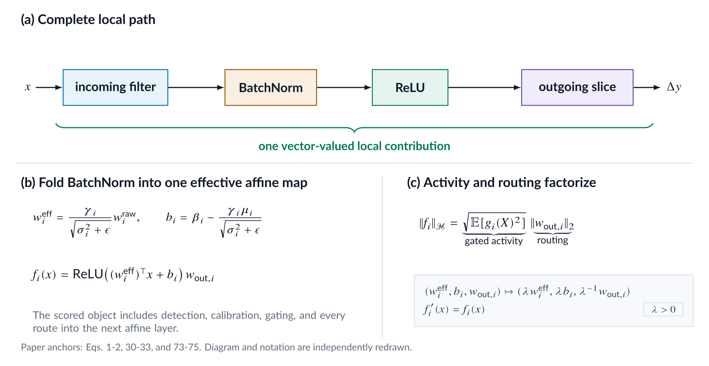
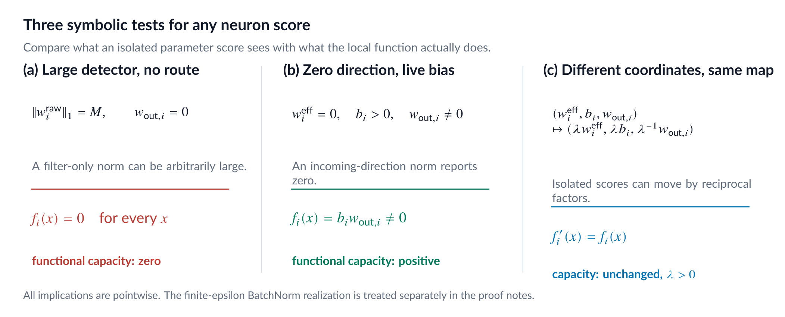
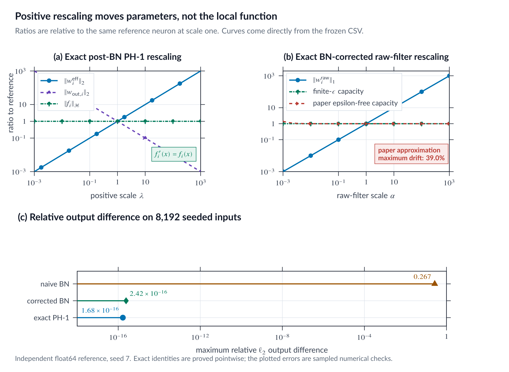

::: {.callout-note appearance="simple"}
## Code and reproducibility

This page is paired with the immutable `v1.0.0` release.

- [Exact audit package](https://github.com/basharelnashef/hope-under-the-microscope/tree/v1.0.0/experiments/audits/part01_positive_rescaling)
- [Focused tests](https://github.com/basharelnashef/hope-under-the-microscope/blob/v1.0.0/experiments/audits/part01_positive_rescaling/test_run.py)
- [Artifact checksums](https://github.com/basharelnashef/hope-under-the-microscope/blob/v1.0.0/artifacts/SHA256SUMS)
- [Evidence: `invariance_metrics.csv`](https://github.com/basharelnashef/hope-under-the-microscope/blob/v1.0.0/artifacts/part_01/results/invariance_metrics.csv)
- [Evidence: `summary.json`](https://github.com/basharelnashef/hope-under-the-microscope/blob/v1.0.0/artifacts/part_01/results/summary.json)

From the repository root:

```bash
python -m unittest discover -s experiments/audits/part01_positive_rescaling -p 'test_*.py' -v
```

Scope: A deterministic local-function audit, not a trained-model compression experiment.

Figure status: This part's three PNGs are static editorial visualizations of
the nearby derivations and authenticated results, not computational outputs.
Their exact published bytes are authenticated by `artifacts/SHA256SUMS`.

:::

## Why two wildly different parameter sets can represent the same contribution

Part 1 of *HOPE Under the Microscope*

Estimated reading time: 15 minutes

---

Take one trained ReLU neuron. Multiply its effective incoming affine map by
1,000. Divide every connection leaving that neuron by 1,000.

The incoming side is now enormous. The outgoing side is tiny. Yet the neuron
computes exactly the same contribution for every input.

Which version is more important?

Functionally, neither. They are the same object written with different
parameters. A pruning score based on only one side can nevertheless rank them
very differently.

This rescaling symmetry is a useful place to begin understanding
[HOPE v1](https://arxiv.org/abs/2607.21366v1), the Hilbert Operator for
Progressive Encoding framework proposed by Hossein Mobahi and Peter L.
Bartlett. Before HOPE asks which neuron to prune or which pair to merge, it
asks a more basic question:

> What should count as a neuron when the goal is to measure function rather
> than parameter size?

Its answer is simple enough to remember:

> A filter detects. BatchNorm calibrates. The activation gates. Outgoing
> weights route. The local function needs all four.

That change in the unit of analysis removes a parameterization ambiguity. It is
also the foundation on which every later part of HOPE is built.

{fig-alt="Three panels show the complete local path, BatchNorm folding, and capacity factorization."}

*Figure 1. A vector-source interpretation of HOPE Sections 3 and 5. The
object being measured is the full local contribution to the next affine layer,
not the incoming filter alone.*

## The filter is an incomplete compression atom

Structured pruning often talks about removing filters or channels. That
language is practical because deleting a channel can remove an incoming filter,
its BatchNorm state, and a slice of the next layer. But the parameter tensor we
delete is not necessarily the right object to score.

Three small examples expose the missing information.

### The loud but disconnected detector

Suppose an incoming filter has a very large norm, but every outgoing connection
from its channel is zero.

The filter may produce a large activation. Nothing consumes it. Its
contribution to the next affine layer is exactly zero.

If the scalar activation is $g_i(x)$ and the outgoing vector is
$w_{\mathrm{out},i}$, then

$$
f_i(x)=g_i(x)w_{\mathrm{out},i}.
$$

Therefore,

$$
w_{\mathrm{out},i}=0
\quad\Longrightarrow\quad
f_i(x)=0
\quad\text{for every }x.
$$

An incoming-weight norm cannot see the disconnection.

### The zero filter with a live bias

Now reverse the situation. Let both the raw incoming filter and its effective
incoming vector be zero, but let the effective bias be positive:

$$
w^{\mathrm{raw}}_i=0,
\qquad
w^{\mathrm{eff}}_{\mathrm{in},i}=0,
\qquad
b_i>0.
$$

For ReLU,

$$
f_i(x)
=
\operatorname{ReLU}(b_i)w_{\mathrm{out},i},
$$

which is a nonzero constant contribution whenever
$w_{\mathrm{out},i}\ne0$. An incoming-filter norm reports zero even though
the local function is alive.

### The same function with different scales

Consider the dense or one-channel 1x1-convolutional contribution

$$
f(x)
=
\operatorname{ReLU}(w^\top x+b)v.
$$

For any $\lambda>0$, define

$$
\widetilde w=\lambda w,
\qquad
\widetilde b=\lambda b,
\qquad
\widetilde v=\frac{v}{\lambda}.
$$

ReLU is positively homogeneous of degree one:

$$
\operatorname{ReLU}(\lambda z)
=
\lambda\operatorname{ReLU}(z)
\qquad
\text{for }\lambda\ge0.
$$

So

$$
\begin{aligned}
\widetilde f(x)
&=
\operatorname{ReLU}
\left(
\lambda w^\top x+\lambda b
\right)
\frac{v}{\lambda}
\\
&=
\lambda
\operatorname{ReLU}(w^\top x+b)
\frac{v}{\lambda}
\\
&=
f(x).
\end{aligned}
$$

The equality is pointwise. It needs no dataset, Gaussian assumption, or
asymptotic argument.

The incoming norm changes by a factor of $\lambda$. The outgoing norm changes
by $1/\lambda$. The function does not move.

{fig-alt="Three cards show a disconnected large filter, a live bias-only channel, and an exact positive rescaling."}

*Figure 2. Derived examples from the accompanying experiment. The numerical
values are simulated, not reported by the paper.*

These cases do not show that incoming-weight norms are always useless. They
show that an incoming tensor does not contain enough information to identify a
channel's local functional contribution.

## HOPE folds the pieces together

Section 3 of the paper starts with a fully connected presentation. Neuron $i$
has raw incoming weights $w^{\mathrm{raw}}_i$, BatchNorm affine parameters
$(\gamma_i,\beta_i)$, stored mean and variance
$(\mu_i,\sigma_i^2)$, and outgoing weights
$w_{\mathrm{out},i}$.

For the bias-free pre-BN affine map used in paper Eq. 1, BatchNorm can be
absorbed into effective parameters at inference:

$$
w^{\mathrm{eff}}_{\mathrm{in},i}
=
\frac{\gamma_i}
{\sqrt{\sigma_i^2+\epsilon}}
w^{\mathrm{raw}}_i,
\qquad
b_i
=
\beta_i
-
\frac{\gamma_i\mu_i}
{\sqrt{\sigma_i^2+\epsilon}}.
$$

The scalar preactivation and vector-valued contribution are

$$
y_i(x)
=
\left(w^{\mathrm{eff}}_{\mathrm{in},i}\right)^\top x+b_i,
$$

$$
f_i(x)
=
\Psi(y_i(x))w_{\mathrm{out},i}.
$$

If the Conv or Dense layer has a raw affine bias, that bias also contributes to
the folded $b_i$. The equations here match the paper's bias-free definition
and the accompanying reference simulation.

This is HOPE's neuron.

The paper restricts $\Psi$ to positively homogeneous degree-one, or PH-1,
activations for its rescaling arguments. ReLU, Leaky ReLU, PReLU, and linear
activations are named examples. GELU, sigmoid, SiLU, and tanh do not have this
property.

Each component now has a clear job:

- $w^{\mathrm{eff}}_{\mathrm{in},i}$ selects the input direction.
- $b_i$ decides where the nonlinear gate opens.
- $\Psi(y_i)$ says how strongly the neuron fires.
- $w_{\mathrm{out},i}$ says where that scalar signal is sent.

The object is still local. It is the contribution reaching the next affine
layer, not the neuron's complete effect after every downstream nonlinearity.
That distinction will matter later.

## What does "outgoing weight" mean for a convolution?

Appendix B.1 translates the definition to an ordinary convolutional chain.

For filter $i$ in layer $A$, the incoming object is the flattened filter
slice

$$
\operatorname{vec}
\left(
K_A[:,:,:,i]
\right).
$$

That feature map becomes input channel $i$ of the next convolution. Its
outgoing object is therefore the flattened downstream slice

$$
\operatorname{vec}
\left(
K_B[:,:,i,:]
\right).
$$

This is a crucial detail. The outgoing influence is not generally one scalar
per output channel. For a spatial downstream kernel, it includes the complete
spatial slice that consumes channel $i$.

The paper assumes spatial stationarity when converting this convolutional
object into its analytical functional norm. The basic rescaling cancellation
itself is simpler and pointwise: if a channel's activation is multiplied by
$\lambda$, every consumer of that channel must be divided by $\lambda$.

This means the clean proof applies directly to an ordinary chain. Networks with
multiple consumers, grouped convolutions, concatenations, or identity skips
need graph-aware handling. Scaling only one outgoing branch would change the
network.

## A function needs a ruler

Once the neuron is treated as a function, saying that it is "large" requires a
ruler.

HOPE places the vector-valued functions in

$$
\mathcal H
=
L_2(\mathcal X,P_X;\mathbb R^c).
$$

The notation sounds heavier than the idea. It means:

- inputs $x$ are weighted according to a distribution $P_X$;
- the neuron produces a vector in $\mathbb R^c$;
- its average squared output must be finite.

The inner product from Appendix A, Eq. 30, is

$$
\langle f_i,f_j\rangle_{\mathcal H}
=
\mathbb E_{x\sim P_X}
\left[
f_i(x)^\top f_j(x)
\right].
$$

The resulting norm is

$$
\|f_i\|_{\mathcal H}
=
\sqrt{
\mathbb E_{x\sim P_X}
\left[
\|f_i(x)\|_2^2
\right]
}.
$$

In plain language, this is the root-mean-square size of the neuron's local
output under the inputs that $P_X$ considers important.

That last phrase is a dependency, not a detail. Different choices of $P_X$
can assign different geometry to the same functions. Part 3 of this series will
examine how HOPE constructs $P_X$ without the original data. For now, we only
need a fixed distribution to understand the representation.

## Why the operator has rank at most one

Write the scalar gated activity as

$$
g_i(x)
=
\Psi
\left(
\left(w^{\mathrm{eff}}_{\mathrm{in},i}\right)^\top x+b_i
\right).
$$

Then

$$
f_i(x)=g_i(x)w_{\mathrm{out},i}.
$$

The input changes the scalar $g_i(x)$. The vector direction
$w_{\mathrm{out},i}$ stays fixed. Every local output therefore lies in
$\operatorname{span}\{w_{\mathrm{out},i}\}$, which is at most
one-dimensional.

HOPE writes this separation as

$$
f_i
=
g_i\otimes w_{\mathrm{out},i},
$$

and identifies the simple tensor with a Hilbert-Schmidt operator. When both
$g_i$ and $w_{\mathrm{out},i}$ are nonzero, that operator has rank one. If
either factor is zero, $f_i$ is the zero operator and has rank zero.

In the nonzero rank-one case, the formal terminology reduces to two factors.
One describes how the neuron reacts to inputs. The other describes how that
reaction is broadcast.

The tensor structure makes the inner product factor:

$$
\langle f_i,f_j\rangle_{\mathcal H}
=
\underbrace{
\mathbb E[\Psi(y_i)\Psi(y_j)]
}_{K(i,j)}
\,
\langle
w_{\mathrm{out},i},
w_{\mathrm{out},j}
\rangle.
$$

For one neuron, Eqs. 73 through 75 give

$$
\|f_i\|_{\mathcal H}
=
\sqrt{
\mathbb E[\Psi(y_i)^2]
}
\,
\|w_{\mathrm{out},i}\|_2.
$$

This is the central intuition of Part 1:

> Functional capacity is RMS gated activity multiplied by downstream routing
> strength.

Neither factor is enough by itself.

## The exact invariance proof

We can now prove that HOPE's full functional capacity ignores the harmless
positive rescaling from the opening puzzle.

Let

$$
\widetilde y_i(x)=\lambda y_i(x),
\qquad
\widetilde w_{\mathrm{out},i}
=
\frac{w_{\mathrm{out},i}}{\lambda},
\qquad
\lambda>0.
$$

For a PH-1 activation,

$$
\Psi(\widetilde y_i)
=
\lambda\Psi(y_i).
$$

Therefore,

$$
\widetilde f_i(x)
=
\Psi(\widetilde y_i)
\widetilde w_{\mathrm{out},i}
=
\lambda\Psi(y_i)
\frac{w_{\mathrm{out},i}}{\lambda}
=
f_i(x).
$$

The self-kernel transforms as

$$
\widetilde K(i,i)
=
\mathbb E[\Psi(\lambda y_i)^2]
=
\lambda^2K(i,i).
$$

Meanwhile,

$$
\left\|
\widetilde w_{\mathrm{out},i}
\right\|_2
=
\frac{
\|w_{\mathrm{out},i}\|_2
}{\lambda}.
$$

Combining the two:

$$
\begin{aligned}
\|\widetilde f_i\|_{\mathcal H}
&=
\frac{\|w_{\mathrm{out},i}\|_2}{\lambda}
\sqrt{\lambda^2K(i,i)}
\\
&=
\|w_{\mathrm{out},i}\|_2
\sqrt{K(i,i)}
\\
&=
\|f_i\|_{\mathcal H}.
\end{aligned}
$$

This is not merely a score that happens to be stable. The underlying local
function is identical.

## How the exact rescaling appears in a real BN network

The clean physical realization leaves the raw filter and stored BatchNorm
moments fixed, then applies

$$
\gamma_i\mapsto\lambda\gamma_i,
\qquad
\beta_i\mapsto\lambda\beta_i,
\qquad
w_{\mathrm{out},i}
\mapsto
\frac{w_{\mathrm{out},i}}{\lambda}.
$$

The folded definition from paper Eq. 1 immediately gives

$$
w^{\mathrm{eff}}_{\mathrm{in},i}
\mapsto
\lambda w^{\mathrm{eff}}_{\mathrm{in},i},
\qquad
b_i\mapsto\lambda b_i.
$$

This transformation is exact at finite BatchNorm $\epsilon$, provided the
scale is positive and every outgoing consumer is transformed.

It also shows why a BN-scale score can change while the function stays fixed.
Under this transformation, $|\gamma_i|$ grows by $\lambda$. The outgoing
norm shrinks by $1/\lambda$. The full capacity remains constant.

## Technical note: scaling the raw filter through BatchNorm

Readers focused on the central functional-neuron idea can skip this note on a
first pass. It separates exact post-BN positive rescaling from the related
raw-filter normalization claim.

The paper also discusses normalization invariance. If the raw filter is scaled
by $\alpha>0$, its stored mean and variance should naturally transform as

$$
w^{\mathrm{raw}}
\mapsto
\alpha w^{\mathrm{raw}},
\qquad
\mu\mapsto\alpha\mu,
\qquad
\sigma^2\mapsto\alpha^2\sigma^2.
$$

Ignoring $\epsilon$, BatchNorm cancels $\alpha$. At finite $\epsilon$,
however,

$$
\frac{
\alpha(z-\mu)
}{
\sqrt{\alpha^2\sigma^2+\epsilon}
}
=
\frac{
z-\mu
}{
\sqrt{\sigma^2+\epsilon/\alpha^2}
}.
$$

This is not exactly equal to the original normalized signal unless
$\epsilon=0$, $\alpha=1$, or both $\sigma^2$ and
$\alpha^2\sigma^2$ dominate $\epsilon$.

An exact inference reparameterization can compensate through $\gamma$:

$$
\widetilde\gamma
=
\gamma
\frac{
\sqrt{\alpha^2\sigma^2+\epsilon}
}{
\alpha\sqrt{\sigma^2+\epsilon}
}.
$$

With this compensation, both effective parameters in paper Eq. 1 remain
exactly fixed.

This qualification matters. Exact post-BN positive rescaling and raw-filter
normalization are related, but they are not the same transformation. The first
is exact for positive scales. The second needs the finite-$\epsilon$ caveat
or compensation.

## The framework-independent numerical check

The accompanying NumPy reference models the algebra of a one-channel 1x1
Conv-BN-ReLU-Conv path. It is a framework-independent simulation, not a
PyTorch or TensorFlow module test. A 1x1 convolution is a matrix multiplication
at every spatial position, which keeps every term of the proof visible.

The experiment uses:

- float64 NumPy;
- 8,192 seeded standard-Gaussian input positions in nine dimensions;
- 25 logarithmically spaced scales from $10^{-3}$ through $10^3$;
- the exact finite-$\epsilon$ variance from paper Eq. 77;
- exact post-BN rescaling and exact finite-$\epsilon$ raw-filter rescaling.

The BN buffers are estimated from those same positions. For every scale, the
script records the local output, isolated parameter scores, empirical RMS
contribution, the finite-$\epsilon$ Gaussian-surrogate capacity, and the
paper's epsilon-free approximation. It also runs the natural uncorrected BN
scaling as a negative control.

The largest relative output error across all 50 invariant transformed
configurations on the evaluation sample was

$$
2.42\times10^{-16}.
$$

The largest deviation of the finite-$\epsilon$ extension from ratio one was

$$
2.22\times10^{-16}.
$$

The isolated parameter scores moved by as much as a factor of 1,000 in either
direction. Under the exact raw-filter transformation, the paper's printed
epsilon-free approximation drifted by 39.0 percent at the most extreme scale.
The figure now displays both formulas.

{fig-alt="Two scale sweeps and one residual panel show parameter movement, invariant capacity, and a finite-epsilon negative control."}

*Figure 3. Derived float64 simulation. Panel A tests exact post-BN PH-1
rescaling. Panel B compares the paper's epsilon-free capacity with an explicit
finite-$\epsilon$ extension under an exact raw-filter reparameterization.
Panel C reports sampled output differences for both exact transformations and
the uncorrected BN negative control. Errors are measured on 8,192 seeded
inputs; the separate algebraic proof is pointwise. No sampling uncertainty is
claimed for the identity itself.*

The core transformation in the implementation is short:

```python
def ph1_rescale(self, scale):
    if scale <= 0:
        raise ValueError("PH-1 rescaling requires a positive scale")
    return replace(
        self,
        gamma=self.gamma * scale,
        beta=self.beta * scale,
        outgoing=self.outgoing / scale,
    )
```

The full script, result table, and tests are linked in the package README.

## What this viewpoint buys us

The functional-neuron definition does several useful things at once.

### It removes an important coordinate choice

A score should not change merely because activation scale was shifted from one
side of a ReLU channel to the other. HOPE's paper capacity passes this exact
post-BN test.

### It notices disconnected features

If the outgoing slice is zero, capacity is zero regardless of how visually
dramatic the incoming filter looks.

### It includes the gate

The effective bias and activation statistics decide whether a channel is
usually silent, occasionally active, or constantly on. Raw filter norm does
not encode that behavior.

### It provides a common geometry under one fixed input model

Exact local functions evaluated under the same fixed $P_X$ share lengths and
alignments in one function-space geometry. This fact alone does not establish
that separately constructed pairwise surrogates assemble into one global
positive-semidefinite geometry; that question is deferred to a later part.

### It gives compression a better first question

Instead of asking, "Which tensor is small?" we can ask, "Which local
vector-valued contribution is small under the chosen input model?"

That question removes a parameterization ambiguity before later assumptions are
judged.

## The questions this creates

It is important to stop exactly where the proof stops.

This post verifies a narrow but useful result:

- the complete local function is invariant to exact positive PH-1 rescaling;
- its $L_2$ norm is invariant under a fixed input distribution;
- isolated tensor scores can change while that function does not.

It leaves three natural questions for the rest of the series:

1. Which input distribution should define the RMS activity?
2. Can many pairwise neuron comparisons share one consistent geometry?
3. How should an abstract functional operation map back to a physical network
   edit?

Part 2 derives the closed-form capacity under HOPE's Gaussian marginal. Part 3
then examines where that marginal comes from.

## The change in the unit of thought

HOPE's first contribution is not a complicated pruning formula. It is a change
in what we agree to call the object.

A filter is a sensor. Its numerical size says little without its calibration,
gate, and wiring. Once those pieces are treated as a single local function,
some apparent differences disappear and some invisible differences become
measurable.

The compact takeaway is:

> If an importance score changes while the function does not, it has measured
> the parameterization rather than the functional contribution.

In Part 2, we will open the RMS term in the capacity factorization. For ReLU
under HOPE's Gaussian marginal, it has a closed form. At zero BatchNorm shift,
the resulting capacity collapses to a surprisingly familiar score.

---

Evidence records:

- `P01-FUNCTIONAL-ATOM`: `paper_claim`
- `P01-POSITIVE-RESCALING`: `verified_fact`
- `P01-FINITE-EPSILON-CAVEAT`: `independent_inference`, verified on the frozen
  reference experiment

Primary source:
[HOPE v1, arXiv:2607.21366v1](https://arxiv.org/abs/2607.21366v1)

Primary anchors: paper Sections 3, 3.1, and 5; Figure 1; Eqs. 1, 2, 30 through
33, 73 through 75, and 77; Appendix B.1.

Code and numerical results:
[Part 1 positive-rescaling audit](https://github.com/basharelnashef/hope-under-the-microscope/blob/v1.0.0/experiments/audits/part01_positive_rescaling/README.md)


