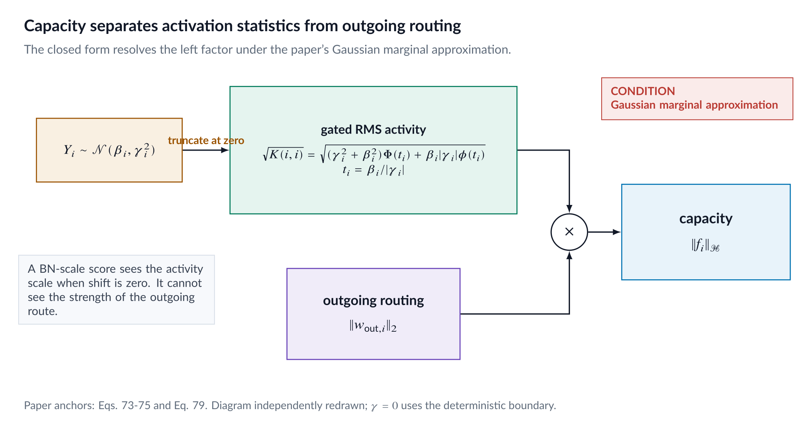
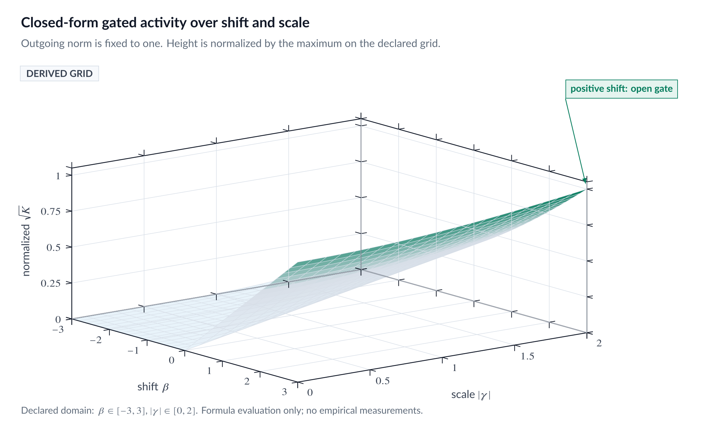
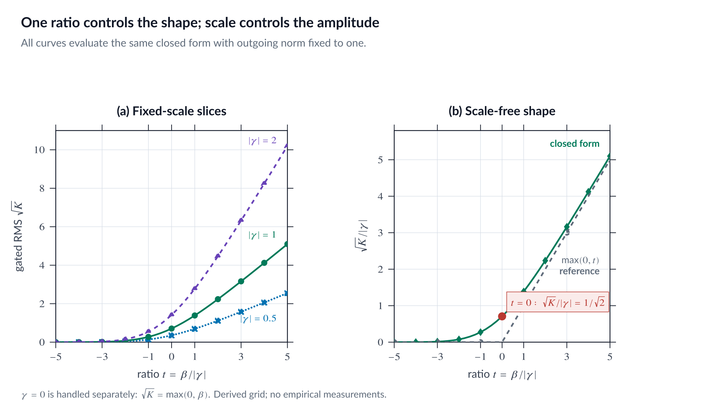
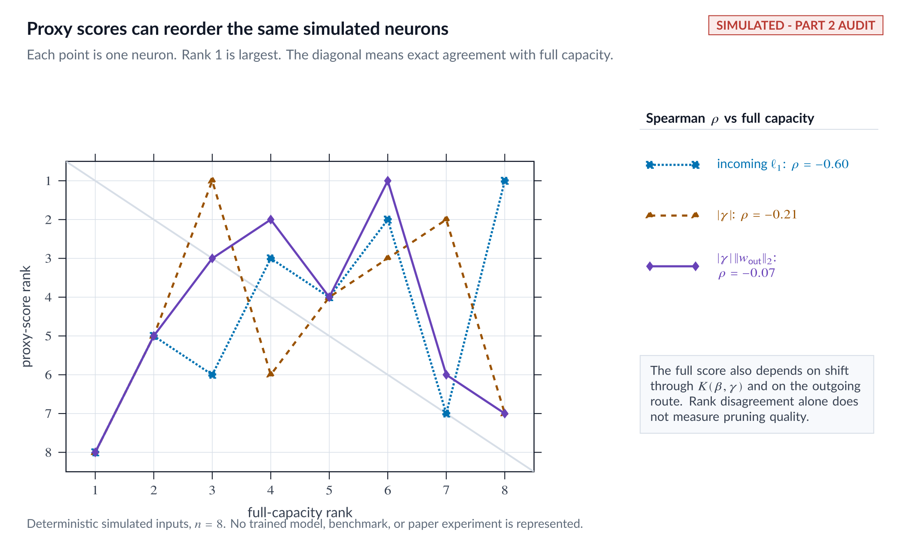

::: {.callout-note appearance="simple"}
## Code and reproducibility

This page is paired with the immutable `v1.0.0` release.

- [Exact audit package](https://github.com/basharelnashef/hope-under-the-microscope/tree/v1.0.0/experiments/audits/part02_capacity)
- [Focused tests](https://github.com/basharelnashef/hope-under-the-microscope/blob/v1.0.0/experiments/audits/part02_capacity/test_run.py)
- [Artifact checksums](https://github.com/basharelnashef/hope-under-the-microscope/blob/v1.0.0/artifacts/SHA256SUMS)
- [Evidence: `metrics.csv`](https://github.com/basharelnashef/hope-under-the-microscope/blob/v1.0.0/artifacts/part_02/results/metrics.csv)
- [Evidence: `summary.json`](https://github.com/basharelnashef/hope-under-the-microscope/blob/v1.0.0/artifacts/part_02/results/summary.json)

From the repository root:

```bash
python -m unittest discover -s experiments/audits/part02_capacity -p 'test_*.py' -v
```

Scope: Analytical and simulated diagnostics only; no paper checkpoint is claimed.

Figure status: This part's four PNGs are static editorial visualizations of
the nearby derivations and authenticated results, not computational outputs.
Their exact published bytes are authenticated by `artifacts/SHA256SUMS`.

:::

## A truncated Gaussian moment, two revealing boundaries, and the simpler score contained inside it

Part 2 of *HOPE Under the Microscope*

Estimated reading time: 18 minutes

Status: published in the `v1.0.0` series from the frozen Part 2 audit package.
Publication does not broaden the evidence scope stated below.

---

Seventy pages of Hilbert geometry eventually produce a surprisingly familiar
pruning statistic.

That is not a criticism. A good mathematical framework should often reduce to
something simple when its assumptions are specialized. The useful questions
are whether the reduction is correct, what information survives it, and which
baseline should be used to judge the extra machinery.

For HOPE's ReLU neuron, the answer begins with one scalar random variable.
Under the paper's negligible-epsilon Gaussian marginal,

$$
Y_i\sim\mathcal N(\beta_i,\gamma_i^2),
$$

and the neuron's squared gated activity is

$$
K(i,i)
=
\mathbb E[\operatorname{ReLU}(Y_i)^2].
$$

The paper gives a closed form for this expectation. We will derive it from the
one-dimensional integral, inspect the cases the displayed formula does not
cover directly, and connect it to the pruning cost.

The most revealing specialization is $\beta_i=0$:

$$
\|f_i\|_{\mathcal H}
=
\frac{|\gamma_i|}{\sqrt2}
\|w_{\mathrm{out},i}\|_2.
$$

So zero-shift HOPE capacity is not BN scale alone. It is BN scale multiplied by
the strength of every outgoing route, with a common $1/\sqrt2$ factor.

## Chapter contract and evidence legend

This chapter answers a narrow question:

> Under HOPE's one-dimensional Gaussian marginal, what exactly is the ReLU
> self-kernel, how should it be evaluated, and what does it imply for solitary
> within-layer pruning?

Every central conclusion uses one of the repository's evidence classes:

- `paper_claim`: what HOPE v1 prints, tied to an exact PDF page and equation.
- `verified_fact`: what this project independently proves or checks.
- `independent_inference`: an interpretation assembled from those premises,
  with its scope stated.

The claim registry keeps the paper's formula separate from our verification:

- `P02-RELU-SELF-KERNEL`: `paper_claim`
- `P02-RELU-SELF-KERNEL-VERIFIED`: `verified_fact`
- `P02-ZERO-SHIFT-CAPACITY`: `verified_fact`
- `P02-DEGENERATE-GAMMA-LIMIT`: `verified_fact`
- `P02-PRUNE-RANK-MONOTONICITY`: `verified_fact`
- `P02-REFINED-BN-BASELINE`: `independent_inference`

The exact source is
[HOPE v1, arXiv:2607.21366v1](https://arxiv.org/abs/2607.21366v1). Its
versioned PDF fingerprint is recorded in the
[paper manifest](https://github.com/basharelnashef/hope-under-the-microscope/blob/v1.0.0/paper/manifest.json).
The paper traceability summary above records every page used here.

## The strongest fair version of the paper's claim

Evidence: `paper_claim`, `P02-RELU-SELF-KERNEL`.

The strongest fair statement is not that HOPE knows a neuron's true activity
without data. It is conditional:

> If the preactivation marginal is modeled by the paper's Gaussian Eq. 78,
> then a ReLU neuron's expected squared activity is available in closed form,
> and the complete local capacity also includes the outgoing weight norm.

Paper Section 5 on PDF pages 7 and 8 defines the vector-valued functional
neuron and its Hilbert norm. Paper Eqs. 73 through 75 on PDF page 52 then
separate its capacity into

$$
\boxed{
\|f_i\|_{\mathcal H}
=
\|w_{\mathrm{out},i}\|_2
\sqrt{K(i,i)}
}.
$$

Paper Eq. 73 defines the scalar kernel as

$$
K(i,j)
=
\mathbb E_{x\sim P_X}
\left[
\Psi(y_i)\Psi(y_j)
\right].
$$

For one neuron and ReLU,

$$
K(i,i)
=
\mathbb E[\max(0,Y_i)^2].
$$

Paper Eq. 3 on PDF page 9 and Eq. 79 on PDF page 53 print

$$
\boxed{
K(i,i)
=
(\gamma_i^2+\beta_i^2)
\Phi\left(\frac{\beta_i}{|\gamma_i|}\right)
+
\beta_i|\gamma_i|
\phi\left(\frac{\beta_i}{|\gamma_i|}\right)
}
$$

for the positive-variance setting stated in Theorem E.2.

The claim is useful for two reasons. The high-dimensional input has disappeared
from the final integration, and the output routing remains visible as a
separate multiplier. Once the marginal parameters are available, each
self-capacity is a constant-size scalar computation plus an outgoing-vector
norm.

This chapter verifies that scalar computation. It does not verify how well the
Gaussian marginal describes a trained network. That empirical question belongs
to Part 3.

## From a functional norm to one truncated moment

Write the gated scalar response as

$$
g_i(x)=\operatorname{ReLU}(y_i(x)),
$$

and the local vector contribution as

$$
f_i(x)=g_i(x)w_{\mathrm{out},i}.
$$

Then

$$
\begin{aligned}
\|f_i\|_{\mathcal H}^2
&=
\mathbb E
\left[
\|g_i(x)w_{\mathrm{out},i}\|_2^2
\right]
\\
&=
\mathbb E[g_i(x)^2]
\|w_{\mathrm{out},i}\|_2^2
\\
&=
K(i,i)
\|w_{\mathrm{out},i}\|_2^2.
\end{aligned}
$$

Taking the nonnegative square root recovers paper Eq. 75.

In plain language:

> Capacity is RMS gated activity multiplied by downstream routing strength.

The first factor asks how much scalar signal crosses the ReLU threshold under
the chosen marginal. The second asks how strongly the next affine layer uses
that signal.

{fig-alt="A product diagram separates gated RMS activity from outgoing routing strength."}

*Figure 1. Capacity factorization from paper Eqs. 73 through 75. This is a
derived explanatory visual, not an experimental result.*

## The Gaussian assumption enters before the closed form

Evidence: `paper_claim`.

The order of Eqs. 77 and 78 matters.

On PDF page 52, paper Eq. 77 retains finite BatchNorm epsilon:

$$
\operatorname{Var}(Y_i)
=
\gamma_i^2
\frac{\sigma_i^2}{\sigma_i^2+\epsilon}.
$$

The paper then says that epsilon is assumed negligible compared with the raw
pre-BatchNorm variance. Under that approximation, Eq. 78 writes

$$
Y_i\sim\mathcal N(\beta_i,\gamma_i^2).
$$

The closed form in Eq. 79 follows from this latter marginal. It is not a
finite-epsilon formula printed by the paper.

For now, follow Eq. 78 exactly. Let

$$
s_i=|\gamma_i|>0,
\qquad
a_i=\frac{\beta_i}{s_i}.
$$

The absolute value is not cosmetic. A Gaussian standard deviation is
nonnegative, while the BatchNorm affine scale $\gamma_i$ can have either
sign. The marginal variance depends on $\gamma_i^2$.

## Deriving the closed form

Evidence: `verified_fact`, `P02-RELU-SELF-KERNEL-VERIFIED`. The frozen
executable audit passed its declared implementation gates.

The derivation starts from the density rather than the printed answer:

$$
K(i,i)
=
\int_0^\infty
y^2
\frac{1}{s_i}
\phi\left(\frac{y-\beta_i}{s_i}\right)
\,dy.
$$

Only $y>0$ remains because ReLU zeros the negative half-line.

Standardize with

$$
z=\frac{y-\beta_i}{s_i},
\qquad
y=s_i z+\beta_i.
$$

When $y=0$, the lower limit becomes $-a_i$, so

$$
K(i,i)
=
\int_{-a_i}^{\infty}
(s_i z+\beta_i)^2\phi(z)\,dz.
$$

Expanding the square reduces the problem to three standard-normal tail
moments:

$$
\int_{-a}^{\infty}\phi(z)\,dz=\Phi(a),
$$

$$
\int_{-a}^{\infty}z\phi(z)\,dz=\phi(a),
$$

and

$$
\int_{-a}^{\infty}z^2\phi(z)\,dz
=
\Phi(a)-a\phi(a).
$$

The first identity uses Gaussian symmetry. The second follows from
$\phi'(z)=-z\phi(z)$. The third follows by integration by parts.

Insert all three:

$$
\begin{aligned}
K(i,i)
={}&
s_i^2[\Phi(a_i)-a_i\phi(a_i)]
\\
&+2\beta_i s_i\phi(a_i)
+\beta_i^2\Phi(a_i).
\end{aligned}
$$

Because $s_i a_i=\beta_i$, one of the two cross terms cancels:

$$
-s_i^2a_i\phi(a_i)
+2\beta_i s_i\phi(a_i)
=
\beta_i s_i\phi(a_i).
$$

Therefore,

$$
K(i,i)
=
(s_i^2+\beta_i^2)\Phi(a_i)
+\beta_i s_i\phi(a_i),
$$

which is exactly the formula printed in Eq. 79 after substituting
$s_i=|\gamma_i|$.

The intimidating part of the expression is mostly bookkeeping. It is the
second moment of a one-dimensional Gaussian after its negative half has been
cut away.

## A normalized view of the gate

For $s_i>0$, write $\beta_i=s_i a_i$. Then

$$
K(i,i)=s_i^2h(a_i),
$$

with

$$
h(a)=(1+a^2)\Phi(a)+a\phi(a).
$$

The dimensionless function $h$ says how the ReLU gate changes the second
moment. The scale $s_i^2$ says how large the underlying Gaussian is.

Three regimes are easy to read:

- $a\ll0$: the mean sits below the threshold, so only a small positive tail
  contributes.
- $a=0$: the symmetric Gaussian sends half its squared energy through ReLU.
- $a\gg0$: almost all mass lies above zero, so the moment approaches the
  untruncated value $\beta_i^2+s_i^2$.

The next surface plots $\sqrt{K(i,i)}$ with unit outgoing norm, then divides
every value by the maximum on its declared display grid. That grid
normalization is only for visualization.

{fig-alt="A surface shows normalized gated RMS activity across shift and scale, including the deterministic boundary."}

*Figure 2. Analytical gated RMS under the Eq. 78 marginal, normalized to the
maximum on the displayed grid. The zero-scale edge is evaluated by its
deterministic definition, not by dividing by zero.*

{fig-alt="Directly labeled curves show gated RMS and its scale-free form against beta over absolute gamma."}

*Figure 3. Analytical gated-RMS slices; the right panel divides out absolute
gamma to expose the dimensionless $\sqrt{h(a)}$ curve. These curves visualize
the formula; they do not measure a trained checkpoint.*

## Special case 1: zero shift

Evidence: `verified_fact`, `P02-ZERO-SHIFT-CAPACITY`.

Set $\beta_i=0$. Then $a_i=0$, $\Phi(0)=1/2$, and the density term is
multiplied by zero:

$$
K(i,i)
=
\gamma_i^2\Phi(0)
=
\frac{\gamma_i^2}{2}.
$$

Capacity becomes

$$
\boxed{
\|f_i\|_{\mathcal H}
=
\frac{|\gamma_i|}{\sqrt2}
\|w_{\mathrm{out},i}\|_2
}.
$$

This identity is a project derivation from the paper's formula. The paper does
not print it as a separate theorem.

The result is simple, but it preserves an important idea from Part 1. A large
BN scale does not imply a large local contribution if the outgoing slice is
small. If the outgoing slice is zero, capacity is exactly zero.

Conversely, two neurons with equal $|\gamma|$ can have very different
capacities because their downstream routing norms differ.

## What the outgoing norm changes

Compare three zero-shift scores:

$$
S_{\mathrm{BN}}(i)=|\gamma_i|,
$$

$$
S_{\mathrm{out}}(i)=\|w_{\mathrm{out},i}\|_2,
$$

and

$$
S_{\mathrm{refined}}(i)
=
|\gamma_i|\|w_{\mathrm{out},i}\|_2.
$$

The first sees marginal activation scale but not whether the feature is used.
The second sees routing but not how strongly the feature fires. The product
keeps both.

It also respects the positive-rescaling cancellation introduced in Part 1.
If the post-BN affine response is multiplied by a positive $\lambda$ and
every outgoing route is divided by $\lambda$, then $|\gamma|$ grows by
$\lambda$, the outgoing norm shrinks by $1/\lambda$, and their product
stays fixed.

At nonzero shift, the full $h(\beta/|\gamma|)$ factor adds information about
where the Gaussian lies relative to the ReLU threshold. The refined product is
then a comparator, not an algebraically identical replacement.

## Special case 2: zero variance

Evidence: `verified_fact`, `P02-DEGENERATE-GAMMA-LIMIT`.

Theorem E.2 on PDF page 53 assumes $|\gamma_i|>0$. Its displayed formula
contains $\beta_i/|\gamma_i|$, so substituting `gamma = 0` directly is
undefined.

The probability model is not undefined. It becomes deterministic:

$$
Y_i=\beta_i
\quad\text{almost surely}.
$$

Therefore,

$$
\boxed{
K(i,i)=\max(0,\beta_i)^2
}.
$$

This boundary includes three intuitive cases:

- $\beta_i>0$: an always-on constant feature with activity
  $\beta_i^2$;
- $\beta_i=0$: a zero feature;
- $\beta_i<0$: an always-closed ReLU with zero activity.

The boundary is also the continuous $s_i\to0^+$ limit of the integral. But a
numerical implementation should not try to discover it by evaluating an
infinite ratio. It should dispatch the deterministic case explicitly.

## Why a literal transcription is numerically fragile

The closed form is exact on paper and still deserves a careful implementation.

### Division at `gamma = 0`

A literal `beta / abs(gamma)` produces an infinity or `nan`. The correct value
depends on the deterministic ReLU output, so the zero-scale branch must run
before division.

### Cancellation in the negative tail

For a large negative $a=\beta/|\gamma|$, the two closed-form terms are
individually small and nearly equal in magnitude:

$$
(1+a^2)\Phi(a)
\quad\text{and}\quad
a\phi(a).
$$

Their sum is a still smaller positive number. Ordinary floating-point
subtraction can discard significant digits or produce a tiny negative value,
even though a squared moment cannot be negative.

The stable implementation factors out the Gaussian exponential in the
moderately negative tail. Beyond the declared switch, it evaluates an
adaptively truncated Mills-ratio asymptotic series in log space. It checks
nonnegativity and does not treat an arbitrary negative answer as zero.

### Extreme positive ratios

For large positive $a$, the correct limit is

$$
K(i,i)\to\beta_i^2+\gamma_i^2.
$$

The implementation evaluates a scale-normalized form, rejects nonfinite
inputs, and raises on an unrepresentable output instead of silently sending an
`inf` into a ranking.

### Vectorized boundary behavior

Real audits evaluate arrays of neurons. The dispatcher must preserve broadcast
shape, handle positive and negative $\gamma$ identically, and return the exact
deterministic boundary element by element.

The tested source is the authority. The publication article carries two
contiguous excerpts copied from that implementation, not a second
implementation. The first makes both exact boundaries explicit:

```python
    zero_scale = flat_scale == 0.0
    if np.any(zero_scale):
        positive_beta = np.maximum(flat_beta[zero_scale], 0.0)
        with np.errstate(over="ignore", invalid="ignore"):
            deterministic = positive_beta * positive_beta
        if not np.all(np.isfinite(deterministic)):
            raise FloatingPointError(
                "deterministic ReLU self-kernel exceeds float64 range"
            )
        result[zero_scale] = deterministic

    zero_beta = (~zero_scale) & (flat_beta == 0.0)
    if np.any(zero_beta):
        with np.errstate(over="ignore", invalid="ignore"):
            exact_zero_shift = (0.5 * flat_scale[zero_beta]) * flat_scale[zero_beta]
        if not np.all(np.isfinite(exact_zero_shift)):
            raise FloatingPointError("zero-shift ReLU self-kernel exceeds float64 range")
        result[zero_beta] = exact_zero_shift
```

The second shows the cancellation-safe negative-tail path and the final
fail-closed checks:

```python
        negative_ratio = ~nonnegative_ratio
        if np.any(negative_ratio):
            local_ratio = ratio[negative_ratio]
            local_scale = active_scale[negative_ratio]
            tail_logs = np.fromiter(
                (
                    _negative_tail_log_second_moment(float(-value))
                    for value in local_ratio
                ),
                dtype=np.float64,
                count=local_ratio.size,
            )
            log_kernel = 2.0 * np.log(local_scale) + tail_logs
            if np.any(log_kernel > LOG_FLOAT_MAX):
                raise FloatingPointError("ReLU self-kernel exceeds float64 range")
            underflow = log_kernel < LOG_FLOAT_MIN_SUBNORMAL
            values = np.zeros_like(log_kernel)
            with np.errstate(under="ignore"):
                values[~underflow] = np.exp(log_kernel[~underflow])
            active_result[negative_ratio] = values

        if not np.all(np.isfinite(active_result)):
            raise FloatingPointError("ReLU self-kernel produced a non-finite value")
        if np.any(active_result < 0.0):
            raise FloatingPointError("ReLU self-kernel produced a negative value")
        result[general] = active_result
```

Each safeguard exists for a distinct mathematical reason:

1. `abs(gamma)` represents the Gaussian standard deviation.
2. The zero-scale mask implements the degenerate distribution before any
   ratio.
3. The zero-shift mask returns the exact half-variance identity without a CDF
   call.
4. The positive-ratio branch uses scale normalization to avoid overflowed
   intermediates.
5. The negative-tail branch prevents subtractive cancellation.
6. Finiteness and strict nonnegativity checks prevent corrupted ranking
   values.

The complete executable source is
[the Part 2 capacity audit](https://github.com/basharelnashef/hope-under-the-microscope/blob/v1.0.0/experiments/audits/part02_capacity/run.py),
and its fail-closed tests are in
[test_run.py](https://github.com/basharelnashef/hope-under-the-microscope/blob/v1.0.0/experiments/audits/part02_capacity/test_run.py).

## Finite epsilon: a qualification, not a hidden replacement

Evidence: Eq. 77 and Eq. 78 are `paper_claim`; the following substitution is an
`independent_inference` that reuses `P01-FINITE-EPSILON-CAVEAT`.

If finite epsilon must be retained, Eq. 77 gives the marginal standard
deviation

$$
s_{i,\epsilon}
=
|\gamma_i|
\sqrt{
\frac{\sigma_i^2}{\sigma_i^2+\epsilon}
}.
$$

The general truncated-normal derivation remains valid when this value is used
as $s_i$. But that is our finite-epsilon extension of the moment. It is not
what the paper prints in Eq. 79, because Eq. 79 is stated after the Eq. 78
approximation.

This distinction matters near an epsilon-dominated variance. When
$\sigma_i^2\gg\epsilon$, $s_{i,\epsilon}\approx|\gamma_i|$. When the raw
variance is comparable to epsilon, the difference can be material and must be
reported with its parameter domain.

Part 1 already established the related lesson for BatchNorm rescaling: an
epsilon-free approximation should not be called exact at finite epsilon.

## Eq. 6 does not create a new same-layer ranking

Evidence: paper formula is `paper_claim`; derivative and ordering are
`verified_fact`, `P02-PRUNE-RANK-MONOTONICITY`.

Paper Eq. 6 on PDF page 13 gives solitary pruning cost as

$$
J_{\mathrm{prune}}(c)
=
\frac{Nc}{E_a-c},
$$

where $c=\|f_i\|_{\mathcal H}$, $N$ is the layer width factor used by the
cost, and $E_a$ is the pre-action layer capacity.

Now compare candidates in one fixed pre-action layer. Hold $N>0$ and
$E_a>0$ constant, and require $0\le c<E_a$. Then

$$
\begin{aligned}
\frac{dJ_{\mathrm{prune}}}{dc}
&=
N
\frac{(E_a-c)+c}{(E_a-c)^2}
\\
&=
\frac{NE_a}{(E_a-c)^2}
\\
&>0.
\end{aligned}
$$

So, under exactly those conditions, pruning-cost order is capacity order. The
rational transformation changes the spacing between scores but not which
candidate is smallest.

The scope is important:

- It applies to candidates in the same unchanged layer.
- It assumes their capacities lie below the common layer capacity.
- It concerns solitary pruning.
- It does not compare layers with different $N$ or $E_a$.
- It does not cover merge costs, block eviction, parameter payoff, or the next
  greedy state after an edit.

Turning this derivative into a global selection claim would be an unsupported
extrapolation.

## The refined BN baseline

Evidence: `independent_inference`, `P02-REFINED-BN-BASELINE`.

Combine two verified premises:

1. At zero shift,
   $c_i=|\gamma_i|\|w_{\mathrm{out},i}\|_2/\sqrt2$.
2. Within one fixed layer, Eq. 6 is strictly increasing in $c_i$.

It follows that the same solitary pruning ranking is produced by

$$
|\gamma_i|\|w_{\mathrm{out},i}\|_2.
$$

Paper Section 11.1 on PDF page 20 says that its compression plot compares HOPE
against incoming-$L_1$, joint incoming-outgoing-$L_1$, and BN-scale
structured pruning. The listed BN baseline uses $\gamma$ as its proxy. The
paper does not list the product above.

That makes the product a direct baseline for a future controlled comparison.
It would isolate a precise question:

> Does performance come from including outgoing routing, from the nonzero
> shift correction, or from other HOPE actions and modeling choices?

This interpretation should not be sharpened into "the Hilbert construction is
useless." The functional definition still explains why outgoing routing
belongs in the score. It handles disconnected routes. It gives the correct
nonzero-shift moment. It also supports other questions that the zero-shift
solitary-pruning reduction does not answer.

The fair conclusion is narrower:

> Sophisticated framing does not remove the need to compare against the simple
> baseline contained inside the method.

## Independent analytical and numerical agreement

The new audit uses three routes to the same one-dimensional moment.

### Analytical evaluation

The tested vectorized function evaluates the closed form with explicit
boundary and tail handling. The audit records the combined method origin as
`paper_formula_independent_stable_implementation`: Eq. 79 supplies the paper
formula, while the numerical dispatcher and deterministic boundary are
independent project work.

### Deterministic quadrature

The audit independently integrates

$$
\int_0^\infty
y^2
\frac{1}{s\sqrt{2\pi}}
\exp\left[-\frac{(y-\beta)^2}{2s^2}\right]
\,dy
$$

on a declared parameter grid. Because this route does not reuse the
closed-form algebra and has no sampling noise, it is the primary numerical
reference.

The frozen 256-node Gauss-Legendre audit crossed ratios
$\{-8,-4,-1,0,1,4,8\}$ with signed gamma scales
$\{-3,-0.25,0.25,3\}$, for 28 cases on the active part of
$[-12,12]$. Every case passed the combined gate
$$
|K_{\mathrm{quad}}-K_{\mathrm{analytical}}|
\le
5\times10^{-14}
+
5\times10^{-11}|K_{\mathrm{analytical}}|.
$$
The maximum absolute discrepancy was
$3.410605131648481\times10^{-13}$; the maximum scaled error was
$1.3079565430043264\times10^{-4}$ tolerance multiples. Repeating the
quadrature produced zero maximum absolute difference.

### Seeded Monte Carlo

The secondary check estimates

$$
\frac1M\sum_{m=1}^{M}\operatorname{ReLU}(\beta+sZ_m)^2,
\qquad
Z_m\sim\mathcal N(0,1).
$$

It records a seed and configurable sample count. Its acceptance rule must
allow for sampling variability, especially in rare positive tails.

All six frozen Monte Carlo cases passed with 200,000 samples per case and seed
`20260801`. The acceptance tolerance was $5\times10^{-14}$ plus seven
estimated standard errors. The maximum absolute error was
$0.013082247044492235$, and the maximum scaled error was
$0.19622037094506206$ tolerance multiples.

The full [audit README](https://github.com/basharelnashef/hope-under-the-microscope/blob/v1.0.0/experiments/audits/part02_capacity/README.md)
defines the grid, tolerances, environment record, and output schema. The
[frozen summary](https://github.com/basharelnashef/hope-under-the-microscope/blob/v1.0.0/artifacts/part_02/results/summary.json)
is the source for the final numerical sentences, while the
[artifact checksum index](https://github.com/basharelnashef/hope-under-the-microscope/blob/v1.0.0/artifacts/SHA256SUMS)
authenticates the published result files.

Monte Carlo agreement is not the proof. The derivation above is the proof;
quadrature and simulation test that the implementation matches it.

## What the simulated ranking comparison can show

The audit also scores one generated neuron table four ways:

1. incoming $L_1$ norm;
2. absolute BN scale $|\gamma|$;
3. refined zero-shift score
   $|\gamma|\|w_{\mathrm{out}}\|_2$;
4. full capacity
   $\|w_{\mathrm{out}}\|_2\sqrt{K(i,i)}$.

At zero shift, scores 3 and 4 must have the same ranking. The common factor
$1/\sqrt2$ cannot reorder anything. With nonzero shifts, the full score can
move neurons whose Gaussian mass lies differently relative to zero.

The outgoing factor can also reorder equal-$|\gamma|$ neurons, and it sends a
disconnected neuron to zero capacity.

{fig-alt="A rank scatter compares three simulated proxy scores with full capacity."}

*Figure 4. Simulated ranking comparison. The inputs are generated by this
project and do not come from the paper's model, plot, or checkpoint.*

On the frozen eight-neuron simulated table, the four methods produced four
distinct descending score orders, and no proxy order matched full capacity.
Kendall's tau against full capacity was $-0.5$ for incoming $L_1$,
$-0.21428571428571427$ for $|\gamma|$, and
$-0.07142857142857142$ for
$|\gamma|\|w_{\mathrm{out}}\|_2$. Every method's eight score values were
distinct, so no tie rule affected these ranks.

This is a mathematical and diagnostic comparison, not a pruning benchmark. It
does not measure accuracy loss, latency, FLOPs, or the quality of a real
checkpoint. It cannot establish that one score is empirically superior.

## What the paper's experiment says, and what we did not reproduce

Evidence: `paper_claim` for the following description of Section 11.1.

On PDF page 20, the paper says it evaluates a public Keras ResNet-50 checkpoint
pretrained on ImageNet. It lists three structured magnitude baselines and says
the displayed HOPE curve has superior accuracy in that plot.

Part 2 does not reproduce that experiment. The independent audit has no
ResNet-50 checkpoint, ImageNet evaluation, structural surgery, fine-tuning,
or accuracy measurement. Its ranking table is simulated and addresses only
how the scalar scores order controlled inputs.

The inherited review also records that the Section 11.1 plot lacks the exact
numeric table and protocol detail required for an exact reproduction. The
legacy adapted compression outputs in this repository have mismatched
checkpoint provenance and are excluded. None of those values appears here.

## What checks out

The frozen executable audit passed, and the Part 2 result is constructive:

- The printed ReLU self-kernel follows from a standard truncated-normal
  second moment.
- The high-dimensional input integral really does reduce to one scalar
  marginal once that marginal is assumed.
- The outgoing norm has a clear functional role.
- The zero-shift identity exposes an interpretable direct baseline.
- The deterministic zero-variance boundary is simple and continuous.
- Eq. 6 preserves capacity order within one fixed layer.

The formula's simplicity is a strength. It makes the assumptions and baseline
comparisons easier to see.

## What remains outside this result

The proof stops at the self-kernel.

It does not establish:

- that real preactivations are Gaussian;
- that BN moments alone determine the right input model;
- any cross-neuron kernel;
- global positive-semidefiniteness of a multi-neuron Gram matrix;
- correctness of the maximum-entropy construction;
- physical merge semantics;
- block-eviction correctness;
- DEFT guarantees;
- compression accuracy from any simulated ranking.

Those are Parts 3 through 12. Cross-neuron geometry and maximum entropy appear
here only as boundary labels so that a one-neuron result is not accidentally
presented as a global theorem.

## Source and reproduction matrix

| Statement | Evidence class | Exact source or project evidence |
|---|---|---|
| Functional capacity is outgoing norm times square root of self-kernel | `paper_claim` | PDF page 8, Section 5; PDF page 52, Eqs. 73 through 75 |
| Biased ReLU self-kernel is the Eq. 79 closed form | `paper_claim` | PDF page 9, Eq. 3; PDF page 53, Eq. 79 and Theorem E.2 |
| Eq. 78 uses the negligible-epsilon marginal | `paper_claim` | PDF page 52, Eqs. 77 and 78 plus intervening sentence |
| Truncated-normal derivation agrees with Eq. 79 | `verified_fact` | Calculations above and `python -m unittest discover -s experiments/audits/part02_capacity -p 'test_*.py' -v` |
| Zero shift gives $K=\gamma^2/2$ | `verified_fact` | Calculations above, frozen summary, and boundary tests |
| Zero variance gives $K=\max(0,\beta)^2$ | `verified_fact` | Calculations above, frozen summary, and boundary tests |
| Eq. 6 is increasing in capacity within a fixed layer | `verified_fact` | PDF page 13, Eq. 6; derivative here; audit ranking test |
| Product score is the direct zero-shift comparator | `independent_inference` | Verified premises above; PDF page 20 baseline list |
| Analytical, quadrature, and Monte Carlo values agree within declared gates | `verified_fact` | [Audit](https://github.com/basharelnashef/hope-under-the-microscope/blob/v1.0.0/experiments/audits/part02_capacity/README.md), [summary](https://github.com/basharelnashef/hope-under-the-microscope/blob/v1.0.0/artifacts/part_02/results/summary.json), and focused tests |
| Four-way ranking comparison | `independent_inference` for the diagnostic design; `verified_fact` only for frozen calculations on the generated table | [Metrics CSV](https://github.com/basharelnashef/hope-under-the-microscope/blob/v1.0.0/artifacts/part_02/results/metrics.csv); explicitly simulated |

## The capacity hidden in plain sight

HOPE's self-kernel is analytically correct under its stated marginal. Its
derivation is a clean truncated-Gaussian calculation, and its boundary cases
make the statistic easier to interpret.

At zero shift, the full solitary capacity is simply

$$
\frac{1}{\sqrt2}
\times
\text{absolute BN scale}
\times
\text{outgoing L2 norm}.
$$

That is more informative than BN scale alone and much simpler than the Hilbert
terminology might suggest. Both facts can be true at once.

The right response is not to dismiss the framework. It is to test the exact
incremental value of each layer of structure against the baseline that the
framework itself reveals.

The compact takeaway is:

> A sophisticated derivation earns trust by exposing its simplest special
> case, then competing against it directly.

Part 3 will examine the assumption upstream of this formula: what HOPE's
"data-free" Gaussian marginal knows, what it reconstructs, and what remains
untested.

---

Evidence records:

- `P02-RELU-SELF-KERNEL`: `paper_claim`
- `P02-RELU-SELF-KERNEL-VERIFIED`: `verified_fact`, frozen audit passed
- `P02-ZERO-SHIFT-CAPACITY`: `verified_fact`
- `P02-DEGENERATE-GAMMA-LIMIT`: `verified_fact`
- `P02-PRUNE-RANK-MONOTONICITY`: `verified_fact`
- `P02-REFINED-BN-BASELINE`: `independent_inference`

Primary source:
[HOPE v1, arXiv:2607.21366v1](https://arxiv.org/abs/2607.21366v1)

Primary anchors: PDF pages 7 through 9, 13, 20, 52, and 53; Section 5;
Section 11.1; Eqs. 3, 6, 73 through 75, and 77 through 79; Proposition E.1;
Theorem E.2.

Code and numerical evidence:
[Part 2 capacity audit](https://github.com/basharelnashef/hope-under-the-microscope/blob/v1.0.0/experiments/audits/part02_capacity/README.md)


