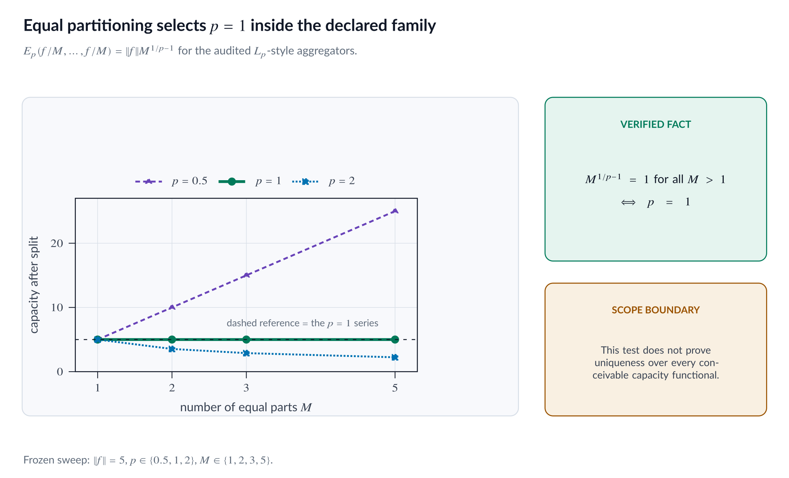
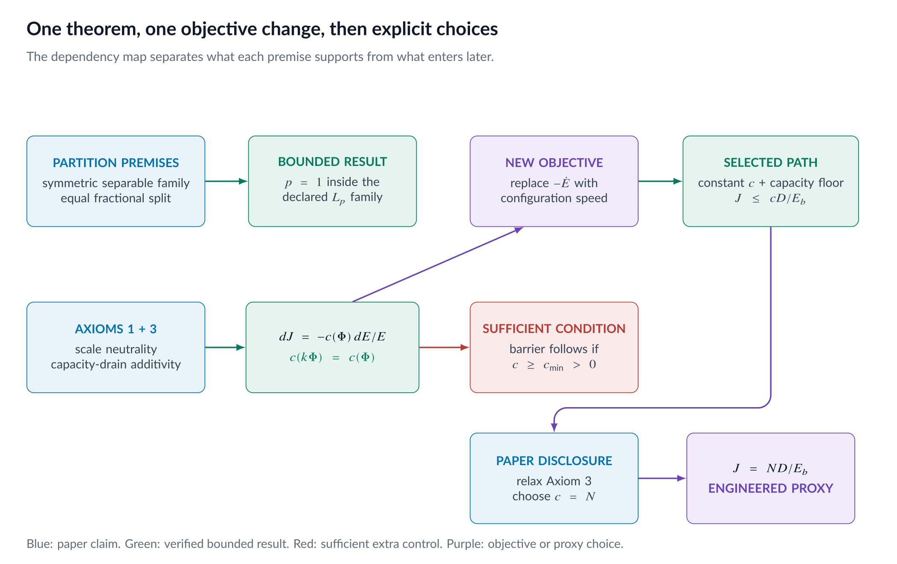
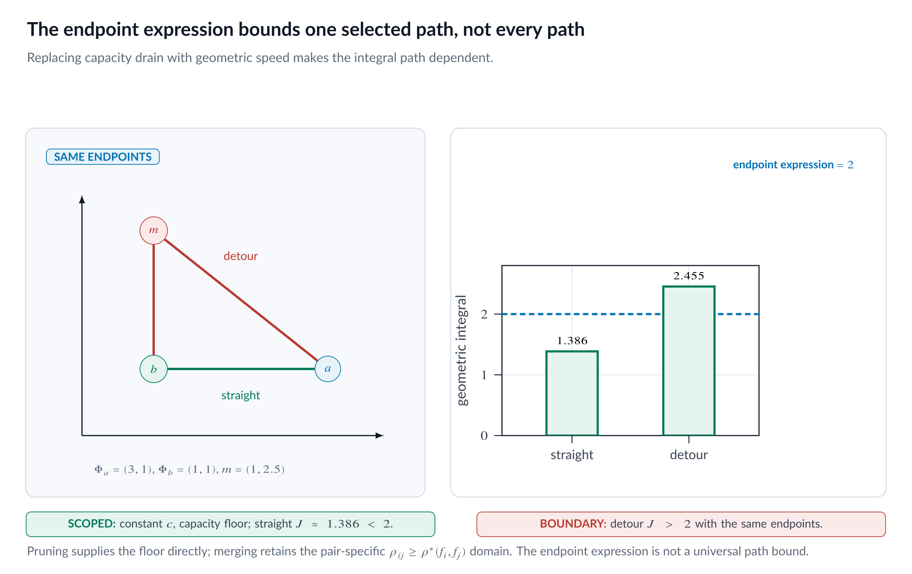
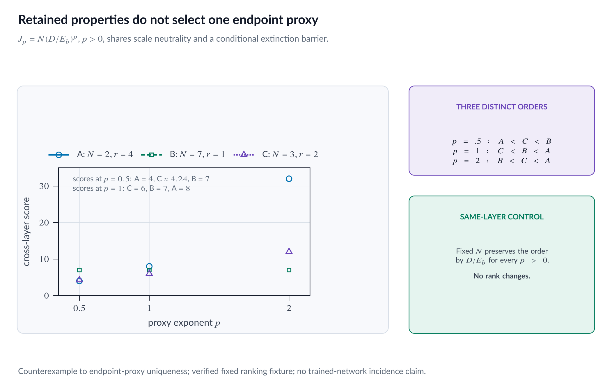

::: {.callout-note appearance="simple"}
## Code and reproducibility

This page is paired with the immutable `v1.0.0` release.

- [Exact audit package](https://github.com/basharelnashef/hope-under-the-microscope/tree/v1.0.0/experiments/audits/part06_axioms)
- [Focused tests](https://github.com/basharelnashef/hope-under-the-microscope/blob/v1.0.0/experiments/audits/part06_axioms/test_run.py)
- [Artifact checksums](https://github.com/basharelnashef/hope-under-the-microscope/blob/v1.0.0/artifacts/SHA256SUMS)
- [Evidence: `derivation_steps.csv`](https://github.com/basharelnashef/hope-under-the-microscope/blob/v1.0.0/artifacts/part_06/results/derivation_steps.csv)
- [Evidence: `path_integrals.csv`](https://github.com/basharelnashef/hope-under-the-microscope/blob/v1.0.0/artifacts/part_06/results/path_integrals.csv)

From the repository root:

```bash
python -m unittest discover -s experiments/audits/part06_axioms -p 'test_*.py' -v
```

Scope: The audit distinguishes conditional derivations from independent counterexamples and proposed scoring choices.

Figure status: This part's four PNGs are static editorial visualizations of
the nearby derivations and authenticated tables, not computational outputs.
Their exact published bytes are authenticated by `artifacts/SHA256SUMS`.

:::

## A theorem, a change of objective, a bound, and a useful design choice

An elegant derivation stops being one derivation when its objective changes
halfway through.

That does not make the final objective useless. It changes what can honestly
be claimed for it.

HOPE needs one score that can compare structural edits across layers. The
score should ignore a common rescaling, resist complete layer extinction,
react to feature geometry, and remain cheap enough to evaluate repeatedly.
Those are sensible requirements. The final score,

$$
J_{\mathrm{final}}
=
N\frac{D(\Phi_a,\widetilde\Phi_b)}{E(\Phi_b)},
$$

is also a sensible engineered proxy for them.

The narrower question in Part 6 is logical:

> Which pieces follow from the stated assumptions, and which pieces enter as
> additional modeling or algorithm-design choices?

The answer has two distinct layers of non-uniqueness.

1. The continuous capacity-drain theorem leaves a positive scale-invariant
   factor $c(\Phi)$ unspecified.
2. After the paper explicitly relaxes path additivity, the two retained axioms
   admit endpoint proxies besides the printed linear ratio.

This is not a claim that the paper hides the second transition. Section 6.2
states that Axiom 3 is intentionally relaxed. The issue is how much of the
final formula should still be described as derived from all three axioms.

## Evidence labels used here

- **paper_claim** reports what HOPE v1 states, defines, or proves.
- **verified_fact** is supported by an independent derivation and the scoped
  deterministic Part 6 audit.
- **independent_inference** separates consequences of printed statements from
  the paper's own wording.
- **counterexample** is an explicit construction that refutes a stated
  implication within its declared domain.
- **proposed_repair** changes the presentation or method and is not attributed
  to HOPE v1.
- **open_question** marks something this package does not establish.

The numerical examples below are deterministic mathematical fixtures, not a
paper experiment and not a checkpoint study. The published result files give
their exact machine-readable values, and the focused tests validate them.

## The strongest fair version of the paper's argument

Evidence: **paper_claim** for the paper's capacity, geometric change,
relaxation, and width choice; independently reconstructed **verified_fact**
for the integral family and straight-path bound.

The paper begins with a layer state

$$
\Phi=(f_1,\ldots,f_N)\in\mathcal H^N
$$

and assigns it a scalar capacity

$$
E(\Phi)=\sum_{i=1}^N\|f_i\|_{\mathcal H}.
$$

It motivates a transition cost through three goals:

1. **Magnitude neutrality.** A common positive rescaling of both endpoints
   should not change the cost.
2. **Connectivity preservation.** The cost should diverge as terminal layer
   capacity approaches zero.
3. **Infinitesimal capacity dependence.** Cost should accumulate additively
   along a continuous path and be driven by capacity drain.

Theorem C.2 turns those requirements into a relative capacity-drain integral.
Section 6.2 then observes that scalar capacity drain cannot distinguish two
transitions with the same lost capacity but different geometric movement. The
paper defines a geometric rate, selects a straight path, bounds its varying
denominator by terminal capacity, chooses $c(\Phi)=N$, and instantiates the
resulting endpoint score.

That sequence contains useful mathematics. It also contains several kinds of
step:

- a theorem under explicit assumptions;
- a restriction used to obtain an endpoint expression;
- a new geometric definition;
- a selected path;
- a conditional upper bound;
- an explicit relaxation of one axiom; and
- a width-normalization choice.

Part 6 keeps those categories visible.

## Partition invariance selects the sum inside an $L_p$-style family

Evidence: **paper_claim**, `P06-L1-CAPACITY-CLAIM`; independent
**verified_fact**, `P06-LP-PARTITION-RESULT`.

Let one functional neuron have capacity

$$
e=\|f\|_{\mathcal H}>0.
$$

Consider

$$
E_p(e_1,\ldots,e_N)
=
\left(\sum_{i=1}^N e_i^p\right)^{1/p},
\qquad p>0.
$$

For $p<1$, this is an $L_p$-style aggregator rather than a norm. The
calculation does not require the triangle inequality.

Partition $f$ into $M$ identical fractional operators:

$$
f
\longmapsto
\left(\frac fM,\ldots,\frac fM\right).
$$

Positive homogeneity gives each fraction capacity $e/M$. Therefore

$$
\begin{aligned}
E_p\left(\frac eM,\ldots,\frac eM\right)
&=
\left(M\left(\frac eM\right)^p\right)^{1/p}
\\
&=
M^{1/p-1}e.
\end{aligned}
$$

Requiring equality with $e$ for every positive integer $M$ forces

$$
\frac1p-1=0,
\qquad\text{so}\qquad
p=1.
$$

Within this declared family, the result is exact:

$$
E_1(\Phi)=\sum_i\|f_i\|_{\mathcal H}.
$$

The frozen audit uses $e=5$,

$$
M\in\{1,2,3,5\},
\qquad
p\in\{0.5,1,2\}.
$$

For $p=0.5$, the split capacity grows as $5M$. For $p=1$, it remains
exactly $5$. For $p=2$, it decreases as $5/\sqrt M$. Only the
$p=1$ row is invariant on every declared split and, by the exponent proof,
on every positive integer split.

{fig-alt="Equal-split capacity for the declared p and M values."}

*Figure 1. The equal-split test inside the explicit $L_p$-style family.
Only $p=1$ remains fixed at capacity five.*

## The broader uniqueness statement needs narrower wording

Evidence: **independent_inference** based on direct proof inspection;
`P06-LP-PARTITION-RESULT` is the bounded verified result.

The main text summarizes Lemma C.1 as a uniqueness result for a symmetric,
separable, homogeneous capacity. The appendix states a more specific
quasi-arithmetic form:

$$
E(\Phi)
=
h\left(\sum_{k=1}^N g(\|f_k\|_{\mathcal H})\right),
$$

with $g$ continuous and strictly monotone, plus identity and partition
invariance conditions.

That is a narrower modeling class than symmetry and homogeneity alone. The
printed proof identifies $h=g^{-1}$ on the image of $g$, then applies the
inverse to summed arguments without separately establishing that those
arguments remain in that image or that $h$ is globally injective.

This package does not turn that proof-domain issue into a claim that the lemma
is false. It takes a safer route:

- report the paper's broader uniqueness statement as a **paper_claim**;
- verify the equal-split exponent argument inside the explicit
  $L_p$-style family; and
- avoid saying that partition invariance plus a few informal adjectives rules
  out every other conceivable capacity functional.

"The sum is well motivated" is weaker than "the sum is uniquely forced over
every reasonable functional class."

## The three axioms, written precisely

Evidence: independently reconstructed **verified_fact**,
`P06-CAPACITY-INTEGRAL-FAMILY`, anchored to the paper's three axioms and
Theorem C.2.

Let $\Phi:[0,1]\to\mathcal H^N$ be a differentiable deformation with
endpoints $\Phi_a$ and $\Phi_b$.

Magnitude neutrality requires

$$
J(k\Phi_a,k\Phi_b)=J(\Phi_a,\Phi_b),
\qquad k>0.
$$

Connectivity preservation requires

$$
\lim_{E(\Phi_b)\to0^+}J(\Phi_a,\Phi_b)=\infty.
$$

Infinitesimal capacity dependence writes

$$
J(\Phi_a,\Phi_b)
=\int_0^1-\xi(\Phi(t))\dot E(t)\,dt.
$$

where $\dot E(t)<0$ on the idealized capacity-drain path and
$\xi(\Phi)>0$.

The third statement specifies both the local quantity that accumulates and an
additive continuous-path model.

## What Theorem C.2 determines

Evidence: **verified_fact** from independently reconstructed paper algebra,
`P06-CAPACITY-INTEGRAL-FAMILY`.

Under common positive scaling,

$$
E(k\Phi)=kE(\Phi),
\qquad
\dot E(k\Phi)=k\dot E(\Phi).
$$

For the integral to remain scale neutral on every valid localized path, the
density scales with degree negative one:

$$
\xi(k\Phi)=k^{-1}\xi(\Phi).
$$

Define

$$
c(\Phi)=\xi(\Phi)E(\Phi).
$$

Then $c(k\Phi)=c(\Phi)$, and Eq. 43 becomes

$$
J_{\mathrm{capacity}}(\Phi_a,\Phi_b)
=
\int_0^1
-c(\Phi(t))
\frac{\dot E(t)}{E(\Phi(t))}
\,dt.
\tag{A}
$$

The theorem determines the relative capacity rate $-\dot E/E$. It does not
determine one unique $c(\Phi)$.

For example, while active width is fixed along one continuous piece, both

$$
c(\Phi)=1
\qquad\text{and}\qquad
c(\Phi)=N
$$

are positive and scale invariant. Additional design criteria are needed to
choose between them.

## Connectivity requires more than pointwise positivity

Evidence: **counterexample**,
`P06-CONNECTIVITY-LOWER-BOUND`.

The proof of Theorem C.2 obtains divergence by assuming

$$
c(\Phi(t))\geq c_{\min}>0
$$

along a path to extinction. Under that condition,

$$
J
\geq
c_{\min}\log\left(\frac{E_a}{E_b}\right)
\longrightarrow\infty.
$$

Pointwise positivity and global scale invariance alone do not provide a
uniform lower bound.

For $0<E<1$, define the two-coordinate state

$$
\Phi(E)=(E-E^2,E^2)
$$

and the globally scale-invariant factor

$$
c(\phi_1,\phi_2)
=
\frac{\phi_2}{\phi_1+\phi_2}.
$$

For every $k>0$,

$$
c(k\phi_1,k\phi_2)=c(\phi_1,\phi_2).
$$

Along the declared path only,

$$
c(\Phi(E))
=
\frac{E^2}{E-E^2+E^2}
=
E.
$$

Therefore

$$
\int_{E_b}^{E_a}c(\Phi(E))\frac{dE}{E}
=
\int_{E_b}^{E_a}dE
=
E_a-E_b,
$$

which stays finite as $E_b\to0^+$.

This factor does not satisfy Axiom 2 on the path. That is the point: the
conditions "positive" and "scale invariant" do not make connectivity
preservation automatic. Axiom 2 must constrain the family further.

## Piecewise-constant $c$ creates an endpoint expression

Evidence: reconstructed **verified_fact**,
`P06-CAPACITY-INTEGRAL-FAMILY`.

The paper next restricts $c$ to remain constant during one transition:

$$
c(\Phi(t))=c(\Phi_a).
$$

Equation (A) then integrates exactly:

$$
J_{\mathrm{capacity}}
=
c(\Phi_a)
\log\left(\frac{E_a}{E_b}\right).
$$

The frozen scalar fixture uses

$$
E_a=5,
\qquad
E_b=2,
\qquad
c=3,
$$

and therefore

$$
J_{\mathrm{capacity}}
=
3\log\left(\frac52\right)
\approx2.7488721956.
$$

This endpoint expression still cannot distinguish two edits with the same
capacity drain but different motion in $\mathcal H^N$.

## The central fork: capacity drain becomes geometric speed

Evidence: **paper_claim** and direct source inspection,
`P06-GEOMETRIC-OBJECTIVE-CHANGE`.

For a path that shrinks one coordinate while holding all others fixed,
geometric speed and negative capacity rate coincide:

$$
\|\dot\Phi(t)\|_{\mathcal H^N}
=
-\dot E(t).
$$

The paper calibrates on that special direction and defines

$$
\dot J_{\mathrm{proj}}(t)
\equiv
c(\Phi(t))
\frac{\|\dot\Phi(t)\|_{\mathcal H^N}}{E(\Phi(t))}.
\tag{B}
$$

Equation (B) is Eq. 44. It responds to geometric motion even when scalar
capacity stays fixed.

This is the point where the analytical object changes. Equation (A)
accumulates capacity drain. Equation (B) accumulates geometric arc length
weighted by inverse capacity. They agree on the calibration path, but not on
every deformation by algebra alone.

{fig-alt="Dependency map from the partition assumptions and axioms to Eq. 6."}

*Figure 2. The derivation map labels theorem, restriction, definition, path
choice, bound, relaxed axiom, and width-normalization choice separately.*

## The geometric integral is path dependent

Evidence: independent deterministic calculation supporting the distinction
introduced by `P06-GEOMETRIC-OBJECTIVE-CHANGE`. The stable claim ID remains a
**paper_claim** about Eq. 44; this fixture has no separate claim ID.

Use $\mathcal H=\mathbb R$, two nonnegative coordinates,

$$
E(x,y)=x+y,
\qquad
c=N=2.
$$

Compare paths from

$$
A=(3,1)
\qquad\text{to}\qquad
B=(1,1).
$$

The straight path is

$$
\Phi_s(t)=(3-2t,1).
$$

Its speed is $2$ and its capacity is $4-2t$, so

$$
\begin{aligned}
I_s
&=
2\int_0^1\frac{2}{4-2t}\,dt
\\
&=
2\log2
\\
&\approx1.3862943611.
\end{aligned}
$$

Now detour through

$$
C=(1,2.5).
$$

On $A\to C$, speed is $2.5$, capacity is $4-0.5t$, and the
contribution is

$$
10\log\left(\frac87\right).
$$

On $C\to B$, speed is $1.5$, capacity is $3.5-1.5t$, and the
contribution is

$$
2\log\left(\frac74\right).
$$

Thus

$$
\begin{aligned}
I_d
&=
2\left[
5\log\left(\frac87\right)
+
\log\left(\frac74\right)
\right]
\\
&\approx2.4545455021.
\end{aligned}
$$

The endpoints are identical, but the costs differ. This is not a contradiction
of the paper. Section 6.2 responds by selecting a straight path and bounding
that selected path under a capacity-floor premise.

{fig-alt="Straight and detour paths over the same capacity field."}

*Figure 3. Same endpoints, different Eq. 44 path integrals. The endpoint
expression is a bound for the selected straight path under its stated premise,
not for the displayed detour.*

## The straight-path upper bound

Evidence: independently reconstructed **verified_fact**,
`P06-STRAIGHT-PATH-BOUND`.

Choose

$$
\Phi(t)=(1-t)\Phi_a+t\widetilde\Phi_b.
$$

Its speed is constant:

$$
\|\dot\Phi(t)\|_{\mathcal H^N}
=
D(\Phi_a,\widetilde\Phi_b).
$$

Under the stated capacity-floor condition

$$
E(\Phi(t))\geq E(\Phi_b)>0,
$$

and with $c$ constant on the transition,

$$
\begin{aligned}
J_{\mathrm{proj}}^{\mathrm{straight}}
&=
c(\Phi_a)
\int_0^1\frac{D}{E(\Phi(t))}\,dt
\\
&\leq
c(\Phi_a)\frac{D}{E(\Phi_b)}
\\
&\equiv J_{\mathrm{bound}}.
\end{aligned}
$$

For pruning, the paper verifies this capacity floor directly along the linear
shrink path. For the merge branch, Lemma C.3 supplies it only inside an
existential, pair-specific neighborhood

$$
\rho_{ij}\geq\rho^*(f_i,f_j).
$$

Part 6 carries that condition with the theorem. It does not audit whether a
runtime procedure enforces or encounters the threshold.

For the path fixture,

$$
D(A,B)=2,
\qquad
E(B)=2,
\qquad
c=2,
$$

so the endpoint expression is

$$
J_{\mathrm{bound}}=2.
$$

The selected straight cost is $2\log2<2$. The detour cost is greater than
two, which reinforces the scope: this endpoint expression does not bound an
arbitrary path.

The bound is a configuration-space statement. It is not a demonstrated bound
on final logits, loss, accuracy, or every continuous deformation.

## The paper explicitly relaxes Axiom 3

Evidence: **paper_claim**, `P06-AXIOM3-RELAXATION`.

Proposition C.5 checks magnitude neutrality and connectivity preservation for
the endpoint proxy on its stated structural-transition domain. Section 6.2
then says that infinitesimal capacity dependence and its path additivity are
intentionally relaxed.

This disclosure controls the correct interpretation. The proxy can be judged
by its retained properties, but it should not also be presented as the unique
consequence of the axiom it no longer satisfies.

The loss of additivity is visible in a one-dimensional endpoint fixture. Let

$$
J(E_a,E_b)=2\frac{E_a-E_b}{E_b}.
$$

Then the direct transition $4\to2$ costs

$$
J(4,2)=2.
$$

Splitting it at $3$ gives

$$
J(4,3)+J(3,2)
=
\frac23+1
=
\frac53,
$$

which is not two. This is a deterministic illustration of the relaxation,
not a defect the paper denies.

## Choosing $c(\Phi)=N$

Evidence: **paper_claim** for the printed proposal and rationale;
**independent_inference** for non-uniqueness,
`P06-WIDTH-NORMALIZATION-CHOICE`.

The paper proposes

$$
c(\Phi)=N,
$$

where $N$ is live pre-action width. This normalizes by average terminal
capacity.

Suppose all $N$ active neurons have capacity $\bar e$, and prune one.
Then

$$
D=\bar e,
\qquad
E_b=(N-1)\bar e,
$$

so

$$
J_{\mathrm{prune}}
=
\frac{N}{N-1}.
$$

For wide layers, this is close to one instead of growing with raw layer
capacity. That is a coherent normalization goal. It is still a design
criterion: neither Eq. 43 nor scale invariance uniquely selects $N$.

## Eq. 6 follows from the selected proxy

Evidence: **paper_claim**, `P06-WIDTH-NORMALIZATION-CHOICE`, and reconstructed
**verified_fact**, `P06-STRAIGHT-PATH-BOUND`.

With $c=N$,

$$
J_{\mathrm{final}}
=
N\frac{D}{E_b}.
$$

For solitary pruning,

$$
D=\|f_i\|_{\mathcal H},
\qquad
E_b=E_a-\|f_i\|_{\mathcal H},
$$

which gives

$$
J_{\mathrm{prune}}(i)
=
\frac{N\|f_i\|_{\mathcal H}}
{E_a-\|f_i\|_{\mathcal H}}.
$$

For the paper's two-coordinate pre-deletion target,

$$
D
=
\sqrt{
\|f_i-f_p\|_{\mathcal H}^2
+
\|f_j-f_p\|_{\mathcal H}^2
},
$$

and

$$
E_b
=
E_a
-\|f_i\|_{\mathcal H}
-\|f_j\|_{\mathcal H}
+\|f_p\|_{\mathcal H}.
$$

Substitution gives Eq. 6. Part 6 stops at that algebra. It does not test later
structural execution or the global optimizer.

## A family of endpoint proxies passes the retained tests

Evidence: independent **counterexample** to endpoint-proxy uniqueness,
`P06-ENDPOINT-PROXY-NONUNIQUENESS`.

After Axiom 3 is relaxed, define

$$
r=\frac{D}{E_b}
$$

and consider

$$
J_p=Nr^p,
\qquad p>0.
\tag{C}
$$

The paper uses $p=1$. Other values are independent countermodels to a
uniqueness claim, not methods reported by HOPE v1 and not proposed repairs.

Scale every state by $k>0$. Both $D$ and $E_b$ scale by $k$, so
$r$ is unchanged. Every $J_p$ is magnitude neutral.

On the same fixed-initial structural-transition limit used by the endpoint
proxy, $D/E_b\to\infty$ as $E_b\to0^+$. Therefore

$$
J_p\to\infty
$$

for every $p>0$.

Applying a fixed scalar power also preserves constant-operation evaluation
once $r$ is available. These facts do not restore path additivity. They show
that after it is removed, the retained endpoint properties do not select one
exponent.

## The exponent can change a cross-layer ranking

Evidence: bounded independent **verified_fact**.

Claim: `P06-CROSS-LAYER-RANKING-SENSITIVITY`.

Use three synthetic equal-payoff candidates:

$$
\begin{array}{c|cc}
\text{candidate} & N & r=D/E_b\\
\hline
A & 2 & 4\\
B & 7 & 1\\
C & 3 & 2
\end{array}
$$

At $p=0.5$, their scores are

$$
J_{0.5}(A)=4,
\qquad
J_{0.5}(B)=7,
\qquad
J_{0.5}(C)=3\sqrt2\approx4.242641.
$$

The ascending order is

$$
A<C<B.
$$

At $p=1$,

$$
J_1(A)=8,
\qquad
J_1(B)=7,
\qquad
J_1(C)=6,
$$

and the order is

$$
C<B<A.
$$

At $p=2$,

$$
J_2(A)=32,
\qquad
J_2(B)=7,
\qquad
J_2(C)=12,
$$

and the order is

$$
B<C<A.
$$

The fixture proves possibility, not prevalence or performance impact. It is
not a checkpoint result and not a compression experiment.

There is also an important non-result. If candidates share the same fixed
$N$, have equal payoff, and differ only through positive $r$, then
$r\mapsto r^p$ is strictly increasing for every $p>0$. The exponent does
not change that restricted ordering.

{fig-alt="Endpoint proxy families and the declared ranking fixture."}

*Figure 4. The independent endpoint family preserves common-scale neutrality
and the scoped fixed-initial extinction behavior when $D$ retains a positive
limit, but changes the declared cross-layer ranking as $p$ changes. It does
not measure compression performance.*

## Why $p=1$ remains defensible

Evidence: **independent_inference** from the paper's construction and the
verified family calculation.

Non-uniqueness is not the same as arbitrariness. The printed exponent has at
least three coherent motivations:

1. It is linear in the geometric distance from the straight-line arc-length
   bound.
2. Combined with $c=N$, equal-capacity mean-field pruning costs
   $N/(N-1)$, nearly independent of width.
3. It preserves the direct interpretation of normalized
   configuration-space displacement.

Those are design reasons. A method can defend a design choice without claiming
that every alternative violates the original axioms.

Holding $c=N$ fixed across the family gives equal-capacity behavior

$$
J_p=\frac{N}{(N-1)^p}.
$$

Only $p=1$ is approximately width neutral under that particular
normalization. A different exponent could be paired with another width factor,
which again exposes an added selection criterion.

## What checks out

1. **paper_claim**, `P06-L1-CAPACITY-CLAIM`: HOPE states additive layer
   capacity and presents partition invariance as its justification.
2. **verified_fact**, `P06-LP-PARTITION-RESULT`: in the declared
   $L_p$-style family, equal-split invariance selects $p=1$.
3. **verified_fact**, `P06-CAPACITY-INTEGRAL-FAMILY`: scale neutrality converts
   Axiom 3 into the Eq. 43 family with scale-invariant $c$.
4. **counterexample**, `P06-CONNECTIVITY-LOWER-BOUND`: the divergence proof
   requires additional behavior such as a positive lower bound on $c$.
5. **paper_claim**, `P06-GEOMETRIC-OBJECTIVE-CHANGE`: Eq. 44 changes the local
   rate from capacity drain to geometric speed.
6. **verified_fact**, `P06-STRAIGHT-PATH-BOUND`: under its stated capacity floor,
   the selected straight-path integral is bounded by $cD/E_b$.
7. **paper_claim**, `P06-AXIOM3-RELAXATION`: the paper retains Axioms 1 and 2
   and explicitly relaxes Axiom 3 for the endpoint proxy.
8. **paper_claim**, `P06-WIDTH-NORMALIZATION-CHOICE`: $c=N$ has a clear
   average-capacity rationale and is explicitly proposed by the paper.
9. **counterexample**, `P06-ENDPOINT-PROXY-NONUNIQUENESS`: every $p>0$ in the
   declared endpoint family shares scale neutrality and the same scoped
   extinction limit.
10. **verified_fact**, `P06-CROSS-LAYER-RANKING-SENSITIVITY`: the declared
    three-candidate fixture has different orders at $p=0.5,1,2$.

## What does not follow

- Symmetry and homogeneity alone uniquely force additive capacity.
- Pointwise positive scale-invariant $c$ automatically guarantees an
  extinction barrier on every path.
- Geometric speed is identical to capacity drain on every deformation.
- The endpoint proxy preserves Axiom 3.
- The straight-path expression bounds every path or an end-to-end network
  metric.
- The retained endpoint properties uniquely select $p=1$.
- Alternative exponents improve compression.
- Ranking changes occur within every layer or candidate set.

## A constructive presentation repair

Evidence: **proposed_repair**.

Define

$$
J_{\mathrm{proxy}}=N\frac{D}{E_b}
$$

directly as a normalized configuration-space projection proxy. Then prove its
common-scale invariance, scoped extinction barrier, and locality. Keep the
capacity-drain integral as idealized motivation. State that geometric speed,
the straight path, the capacity floor, and width normalization complete the
executable definition.

That revision leaves the score unchanged while aligning the claim with the
properties the score actually has.

## Source and evidence matrix

| Statement | Evidence label | Anchor or proof |
|---|---|---|
| HOPE defines additive layer capacity | **paper_claim** | Section 6.1, PDF page 10; Lemma C.1, pages 42-43 |
| Equal splitting selects $p=1$ inside the $L_p$-style family | **verified_fact** | Eqs. 58-61, PDF page 50; calculations above |
| Axiom 3 and scale neutrality yield Eq. 43 with free $c$ | **verified_fact**, reconstructed paper algebra | PDF page 43; `derivation_steps.csv` |
| Positive scale-invariant $c$ need not imply the barrier | **counterexample** | calculations above, shape-factor construction |
| Eq. 44 replaces capacity rate with geometric speed | **paper_claim** | Section 6.2, page 11; Eq. 44, page 44 |
| Eq. 44 is path dependent | **verified_fact**, bounded fixture | `path_integrals.csv`; calculations above |
| The selected straight path is bounded by $cD/E_b$ under its premise | **verified_fact**, reconstructed paper algebra | Lemma C.3 and Theorem C.4, Eqs. 45-48, pages 44-46 |
| The endpoint proxy retains Axioms 1 and 2 and relaxes Axiom 3 | **paper_claim** | Section 6.2, page 12; Proposition C.5, page 46 |
| The paper proposes $c=N$ | **paper_claim** | Section 6.2 and Footnote 6, page 12 |
| $J_p=N(D/E_b)^p$ is non-unique under retained properties | **counterexample**, independent family | `proxy_family.csv`; calculations above |
| The three-candidate order changes with $p$ | **verified_fact**, bounded fixture | `ranking_fixture.csv`; calculations above |
| Another exponent improves a real model | **open_question** | Requires a separate compression study |

## Reproduction contract

The deterministic audit lives under
`experiments/audits/part06_axioms/` and writes fresh results outside the
frozen references. The canonical direct command is:

```bash
python3 experiments/audits/part06_axioms/run.py --result-dir <fresh-dir>
```

The audit README records the configuration and tolerances. The focused tests
validate the six-output package, and the artifact checksum index authenticates
the published result-file bytes.

## Scope boundary

Part 6 conditionally grants the capacity and configuration-space geometry in
order to audit the route from assumptions to endpoint score. It does not
revisit Part 5, test physical structural execution, audit block actions,
analyze optimizer complexity, evaluate DEFT, or reproduce a compression
experiment.

## The bounded conclusion

The additive capacity has a clean partition argument inside a declared
$L_p$-style family. The continuous model yields a meaningful relative
capacity-drain family, but leaves $c(\Phi)$ open. Section 6.2 changes the
local objective to geometric speed, selects and bounds a straight path,
explicitly relaxes Axiom 3, and chooses $c=N$ for cross-layer
normalization.

That is enough to motivate

$$
J_{\mathrm{final}}=N\frac{D}{E_b}.
$$

It is not enough to call it the unique consequence of all three axioms. Once
path additivity is gone, the positive-exponent endpoint family passes the two
retained tests under the same scoped extinction domain.

> Separate what a theorem forces from what an algorithm designer chooses.

This article is published in the `v1.0.0` twelve-part package. Its conclusions
remain bounded to the declared derivations, counterexamples, and controls.


