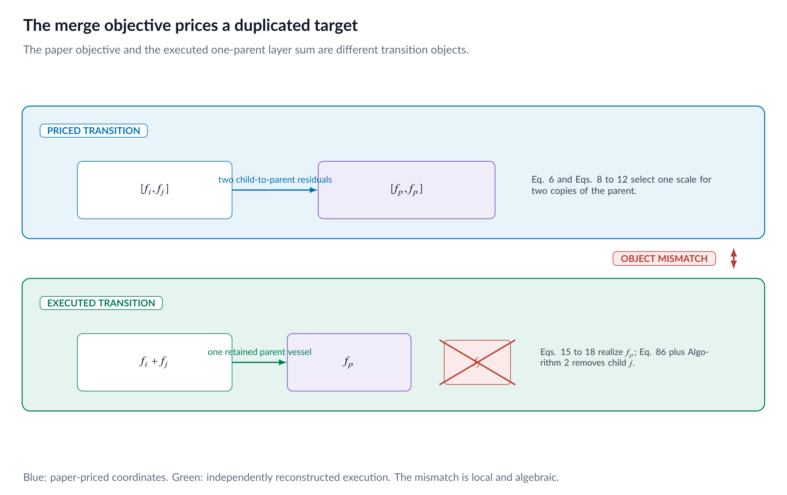
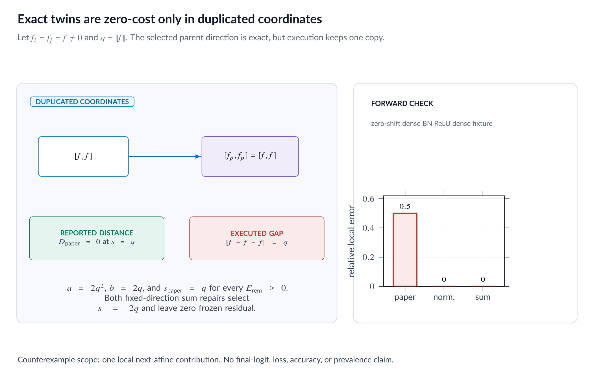
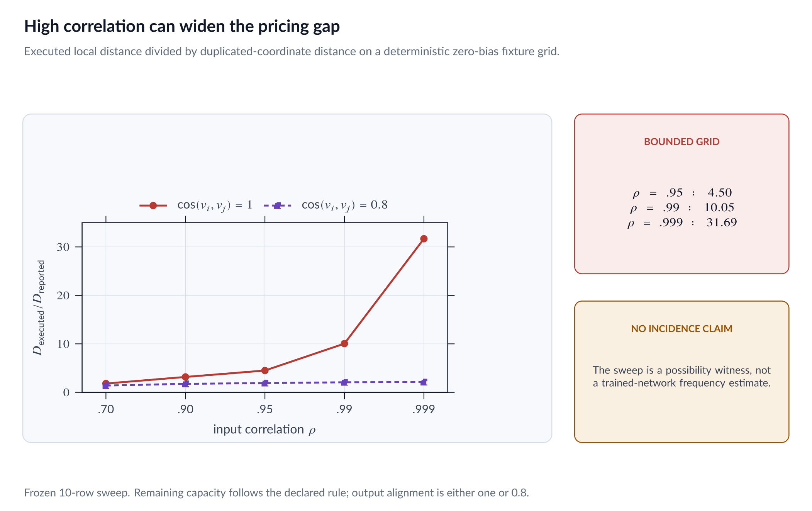
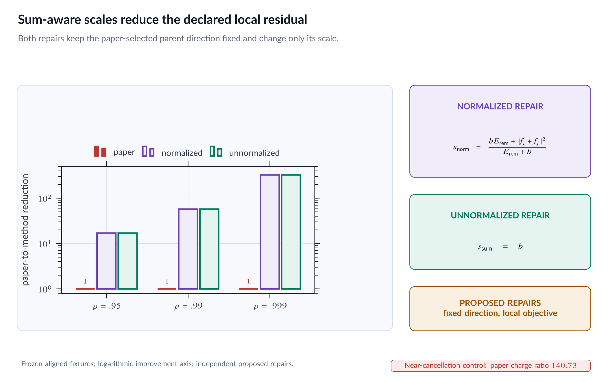

::: {.callout-note appearance="simple"}
## Code and reproducibility

This page is paired with the immutable `v1.0.0` release.

- [Exact audit package](https://github.com/basharelnashef/hope-under-the-microscope/tree/v1.0.0/experiments/audits/part07_merge_semantics)
- [Focused tests](https://github.com/basharelnashef/hope-under-the-microscope/blob/v1.0.0/experiments/audits/part07_merge_semantics/test_run.py)
- [Artifact checksums](https://github.com/basharelnashef/hope-under-the-microscope/blob/v1.0.0/artifacts/SHA256SUMS)
- [Evidence: `twin_cases.csv`](https://github.com/basharelnashef/hope-under-the-microscope/blob/v1.0.0/artifacts/part_07/results/twin_cases.csv)
- [Evidence: `repair_comparison.csv`](https://github.com/basharelnashef/hope-under-the-microscope/blob/v1.0.0/artifacts/part_07/results/repair_comparison.csv)

From the repository root:

```bash
python -m unittest discover -s experiments/audits/part07_merge_semantics -p 'test_*.py' -v
```

Scope: Exact-twin and bounded synthetic fixtures separate paper-literal pricing, physical execution, and proposed repairs.

Figure status: This part's four PNGs are static editorial visualizations of
the nearby derivations and authenticated tables, not computational outputs.
Their exact published bytes are authenticated by `artifacts/SHA256SUMS`.

:::

## A correct projection can still price the wrong transition

Two neurons compute exactly the same nonzero function. A compression method
replaces both with one parent. What should the parent compute?

If the layer adds neuron contributions, the answer is immediate: the parent
must reproduce the sum, $2f$, if the local layer map is to remain unchanged.

HOPE v1 solves a different problem. Its merge objective asks one parent
function to approximate each child coordinate separately:

$$
[f,f]\longrightarrow[f_p,f_p].
$$

That problem selects $f_p=f$ and reports zero distance. The physical update
then keeps only one parent vessel. The executed local transition is

$$
2f\longrightarrow f.
$$

The projection is exact for the state it was asked to fit. The trouble is that
the fitted state is not the state left by the surgery.

Part 7 makes this mismatch explicit, proves it symbolically, realizes the
printed parent in two deterministic dense-BN-ReLU-dense forward fixtures, and
compares two separately labeled repair objectives. The conclusion is narrow
but exact:

> A zero duplicated-coordinate merge distance does not imply zero change in
> the executed local summed contribution.

Nothing here measures final logits, loss, accuracy, or the frequency of these
configurations in trained networks.

## Evidence labels used here

- **paper_claim** reports what HOPE v1 states, defines, or derives.
- **verified_fact** is supported by an independent derivation, direct source
  composition, or the deterministic Part 7 audit.
- **independent_inference** connects printed definitions without attributing
  the conclusion to the paper.
- **counterexample** is an explicit construction that refutes a general
  interpretation within its stated domain.
- **proposed_repair** changes the optimized object and is not paper-literal.
- **open_question** marks something this package does not establish.

The numerical tables are deterministic mathematical fixtures. They are not a
paper experiment, a checkpoint study, or a random sample. The published
result files provide the exact values; the audit README and focused tests
define their tolerances and checks.

## Begin with the strongest fair account of the paper

Evidence: **paper_claim**, `P07-DUPLICATED-TARGET`, and independently checked
source composition for the later execution.

HOPE treats each neuron as a vector-valued function in a Hilbert space. When
merging children $i$ and $j$, it seeks one realizable parent direction and
one positive parent scale. This is a meaningful constrained approximation
problem. The paper also does substantial work to turn the abstract parent
back into physical incoming weights, outgoing weights, and BatchNorm state.

The relevant chain is spread across several places:

1. Eq. 6 prices the two child coordinates against two parent coordinates.
2. Eqs. 8 through 14 choose the parent direction and scale.
3. Eqs. 15 through 18 realize that one parent physically.
4. Eq. 86 defines a tuple's aggregate mapping by summing its components.
5. Algorithm 2 stores the parent in child $i$'s vessel and removes child
   $j$.

Every individual step can be read coherently. The problem appears when the
first and last objects are compared: two parent coordinates are priced, but
one parent contribution remains.

{fig-alt="A map separating the priced duplicated-coordinate transition from the executed local sum transition."}

*Figure 1. Eq. 6 prices two parent coordinates. Eqs. 15 through 18 realize one
parent, and Algorithm 2 leaves one parent vessel. Eq. 86 determines the local
summed contribution on each side.*

## The paper-literal coordinate objective

Evidence: **paper_claim**, `P07-DUPLICATED-TARGET`, anchored to Eq. 6 and
Eqs. 8 through 12 on physical PDF pages 13 through 15.

Fix a unit realizable parent direction $\psi$, and write

$$
f_p=s\psi,
\qquad
\|\psi\|_{\mathcal H}=1,
\qquad
s>0.
$$

Define

$$
a
=
\|f_i\|_{\mathcal H}^2+\|f_j\|_{\mathcal H}^2,
$$

$$
b
=
\langle\psi,f_i+f_j\rangle_{\mathcal H},
$$

and let $R=E_{\mathrm{rem}}\geq0$ be the capacity outside the two children.
The squared duplicated-coordinate distance is

$$
\begin{aligned}
D_{\mathrm{dup}}^2(s)
&=
\|f_i-s\psi\|^2+\|f_j-s\psi\|^2
\\
&=
2s^2-2bs+a.
\end{aligned}
\tag{1}
$$

Ignoring the fixed live-width factor, the squared normalized objective is

$$
Q_{\mathrm{dup}}(s)
=
\frac{2s^2-2bs+a}{(R+s)^2}.
\tag{2}
$$

Under the paper's positive-alignment phase check, $b>0$. Differentiating
Eq. 2 gives the printed scale

$$
s_{\mathrm{paper}}
=
\frac{a+bR}{2R+b}.
\tag{3}
$$

This is the correct stationary scale for the duplicated-coordinate objective.
Part 7 does not dispute that calculus.

## The executed local object is a sum

Evidence: independent **verified_fact**,
`P07-EXECUTED-SUM-TRANSITION`.

Eq. 86 states that the aggregate mapping of a tuple is the sum of its
constituent operators:

$$
\mathcal F(\Phi)=\sum_k f_k.
\tag{4}
$$

Before the merge, the two selected coordinates contribute

$$
f_i+f_j.
$$

Algorithm 2 lines 12 through 14 update capacity, place the parent in child
$i$'s vessel, and remove child $j$. After the merge, the selected region
contributes

$$
f_p=s\psi.
$$

The local residual of the executed transition is therefore

$$
D_{\mathrm{phys}}(s)
=
\|f_i+f_j-s\psi\|_{\mathcal H}.
\tag{5}
$$

If

$$
c=\|f_i+f_j\|_{\mathcal H}^2,
$$

then

$$
D_{\mathrm{phys}}^2(s)
=
s^2-2bs+c.
\tag{6}
$$

Equation 1 and Eq. 6 are not two algebraic expansions of the same distance.
They are distances between different objects.

## The exact-twin counterexample

Evidence: **counterexample**, `MERGE-TWIN-COUNTEREXAMPLE`.

Let the children be nonzero exact twins:

$$
f_i=f_j=f,
\qquad
q=\|f\|_{\mathcal H}>0,
\qquad
\psi=f/q.
$$

The three scalar quantities are

$$
a=2q^2,
\qquad
b=2q,
\qquad
c=4q^2.
\tag{7}
$$

Substitute $a$ and $b$ into the paper scale:

$$
\begin{aligned}
s_{\mathrm{paper}}
&=
\frac{2q^2+2qR}{2R+2q}
\\
&=
q.
\end{aligned}
\tag{8}
$$

This identity holds for every $R\geq0$. The paper parent is

$$
f_p=q\psi=f.
$$

The duplicated-coordinate distance is then

$$
D_{\mathrm{dup}}
=
\sqrt{\|f-f\|^2+\|f-f\|^2}
=0.
\tag{9}
$$

Because the numerator of Eq. 6 is zero and its denominator is positive, the
printed merge cost is zero.

The executed local residual is different:

$$
\begin{aligned}
D_{\mathrm{phys}}
&=
\|f+f-f\|
\\
&=
\|f\|
\\
&=q>0.
\end{aligned}
\tag{10}
$$

Thus the exact same parent is perfect in the duplicated coordinate product
space and imperfect for the one-parent summed layer map.

{fig-alt="An exact-twin calculation showing zero duplicated-coordinate distance and a positive executed sum residual."}

*Figure 2. For exact twins, the paper scale is $q$ for every remaining
capacity. Two priced copies match, while one executed parent leaves residual
$q$.*

## What the counterexample refutes

Evidence: **counterexample**, `MERGE-TWIN-COUNTEREXAMPLE`.

The witness refutes the universal implication

$$
D_{\mathrm{dup}}=0
\quad\Longrightarrow\quad
D_{\mathrm{phys}}=0.
$$

It also refutes any universal interpretation of Eq. 6's merge numerator as
the norm of the executed local aggregate change.

The counterexample does not require a failure of the Hilbert inner product,
a bad parent direction, a floating-point instability, or a BatchNorm recovery
error. It grants the geometry and gives the parent the most favorable possible
direction: the exact child direction.

## What the counterexample does not prove

Evidence: **open_question** boundary.

The witness does not establish:

- how often exact or near twins occur in a trained network;
- a bound on final logits after downstream nonlinearities;
- a loss or accuracy change;
- an end-to-end network norm bound;
- that every merge is harmful;
- that the parent-direction approximation fails; or
- that either proposed repair improves a trained model.

It proves a mismatch between a priced local object and an executed local
object. That is enough to invalidate a universal executed-distortion reading,
but not enough to quantify empirical consequences.

## The physical realization confirms one copy

Evidence: independent **verified_fact**,
`P07-PHYSICAL-FORWARD-TWIN`, anchored to Eqs. 15 through 18.

One possible response to the Hilbert-space proof would be that the physical
parameter reconstruction secretly restores the missing factor of two. The
audit tests that possibility directly.

It builds two deterministic exact-twin dense-BN-ReLU-dense fixtures. Each
fixture contains two identical child paths, a nonzero outgoing vector, and
seven fixed three-dimensional inputs. The first has

$$
\beta=0,
\qquad
\gamma=1.2,
\qquad
q\approx0.7776888838.
$$

The second has

$$
\beta=0.35,
\qquad
\gamma=1.4,
\qquad
q\approx1.0026920316.
$$

The reconstruction uses $\epsilon=10^{-5}$ and the active boundary-safe
variance relation. It follows the paper's input-output scale split and
recovers the effective incoming affine map, outgoing vector, and BN state.

For the paper-literal scale $s=q$, the realized parent output equals one
child contribution within $2\times10^{-12}$ on every declared check. Against
the reference sum of two child contributions, the relative Frobenius error is

$$
\frac{\|f_p-(f_i+f_j)\|_F}{\|f_i+f_j\|_F}
=
\frac12
$$

in both fixtures.

The largest effective-weight, effective-bias, surrogate-scale, or
expected-forward reconstruction discrepancy across all six physical rows is
about $4.44\times10^{-16}$. The physical reconstruction is doing what its
selected scale specifies. It does not create a second parent copy.

This forward check is local. The reference is the summed contribution into
the next affine layer on seven fixed inputs, not final network output.

## Near twins expose a bounded gap

Evidence: **counterexample**, `P07-CORRELATION-GAP`.

The exact-twin limit is decisive, but a single limiting case can hide how the
two distances separate nearby. The audit therefore uses a bounded zero-bias
fixture family.

The incoming directions have correlation

$$
\rho
\in
\{0.7,0.9,0.95,0.99,0.999\}.
$$

The children have equal capacities

$$
q_i=q_j=1/\sqrt2,
$$

and remaining capacity is fixed by

$$
R=32(q_i+q_j).
$$

The parent direction follows the paper's rank-two direction rule and exact
phase check. For aligned outgoing vectors, the ratio

$$
\frac{D_{\mathrm{phys}}(s_{\mathrm{paper}})}
{D_{\mathrm{dup}}(s_{\mathrm{paper}})}
$$

takes these values:

| Input correlation $\rho$ | Duplicated distance | Physical residual | Ratio |
|---:|---:|---:|---:|
| 0.700 | 0.371279 | 0.674453 | 1.8166 |
| 0.900 | 0.218264 | 0.693023 | 3.1752 |
| 0.950 | 0.155445 | 0.699458 | 4.4997 |
| 0.990 | 0.070178 | 0.705416 | 10.0518 |
| 0.999 | 0.022308 | 0.706929 | 31.6901 |

The denominator shrinks toward zero as the pair approaches an exact aligned
twin, while the one-parent physical residual remains near one child scale.

Output alignment matters. Repeating the same input correlations with outgoing
cosine $0.8$ gives ratios

$$
1.3903,
1.7547,
1.9087,
2.0697,
2.1128.
$$

These are ten fixed rows, not a distribution over trained pairs. The audit
supports the listed values and the existence of a gap on this declared family.
It does not support a prevalence claim.

{fig-alt="A bounded correlation sweep comparing the duplicated-coordinate distance with the executed local residual."}

*Figure 3. The true-to-reported distance ratio grows across the aligned-output
fixture as input correlation approaches one. The partially aligned control
shows that output geometry also matters.*

## The large-capacity limit reveals average semantics

Evidence: independent **verified_fact**, `P07-PAPER-SCALE-LIMIT`.

For fixed $a$ and $b>0$, Eq. 3 has the limit

$$
\lim_{R\to\infty}s_{\mathrm{paper}}
=
\lim_{R\to\infty}
\frac{a+bR}{2R+b}
=
\frac b2.
\tag{11}
$$

The factor of two comes from Eq. 1: the same parent scale appears in two
coordinate residuals. In contrast, the orthogonal projection of the physical
sum onto $\psi$ has scale

$$
\langle\psi,f_i+f_j\rangle=b.
$$

The capacity sweep fixes the $\rho=0.95$, aligned-output fixture and varies

$$
R/b
\in
\{0,0.25,1,4,16,64,10^3,10^6\}.
$$

At $R/b=10^6$, the observed $s_{\mathrm{paper}}/b$ differs from $1/2$
by about $6.19\times10^{-9}$. This is a finite check of the exact algebraic
limit, not an empirical network result.

## Near cancellation reveals the opposite mismatch

Evidence: **counterexample**, `P07-NEAR-CANCELLATION`.

The twin case shows undercharging of a physical sum change. A fixed
near-cancellation fixture shows that duplicated coordinates can also remain
large when the physical sum is small.

The two children share the same zero-bias input activation. Their outgoing
vectors point in opposite directions, with magnitudes $1$ and $0.99$.
Their summed function is only one percent of one child's signed contribution.
Relative to the sum of their unsigned capacities, its norm fraction is

$$
0.0050251256,
$$

or about $0.5025\%$.

For the declared remaining-capacity rule, the paper-literal scale gives

$$
D_{\mathrm{dup}}\approx0.9951214,
\qquad
D_{\mathrm{phys}}\approx0.0074569.
$$

The duplicated-coordinate distance is about $140.7314$ times the raw sum
norm $0.0070711$. This fixture does not say that cancellation pairs are
common or desirable to merge. It shows that coordinate closeness and aggregate
sum closeness are genuinely different objectives in both directions.

## The downstream distortion symbol retains the same mismatch

Evidence: **independent_inference**, `P07-H4-DISTORTION-GAP`, anchored to
Proposition H.4 and Eqs. 116 through 118 on physical PDF pages 66 through 67.

Proposition H.4 defines the merge distortion

$$
\delta_k
=
\min_{f_p}
\left(
\sum_{m=1}^{M}\|f_m-f_p\|^2
\right)^{1/2}.
\tag{12}
$$

This is the duplicated-coordinate distance generalized to $M$ children.
The proposition bounds it above by projecting all children to zero, and
Eq. 118 inserts the resulting $\delta_k$ values into a cumulative expression.

For two exact twins, $f_p=f$ gives

$$
\delta_k=0.
$$

Algorithm 2 nevertheless leaves one parent contribution, so the local summed
residual is

$$
\|2f-f\|=q.
$$

The independent conclusion is precise: the displayed $\delta_k$ does not
charge the one-copy removal in this witness. Consequently, Eqs. 116 through
118 do not establish a bound on that executed local residual merely by naming
$\delta_k$ a merge distortion. This conclusion does not quantify final
source-task degradation.

## Repair 1: normalized physical-residual scale

Evidence: **proposed_repair**, `P07-NORMALIZED-SUM-REPAIR`.

Keep the selected unit parent direction $\psi$, but replace the
duplicated-coordinate numerator with the physical sum residual:

$$
Q_{\mathrm{norm}}(s)
=
\frac{s^2-2bs+c}{(R+s)^2},
\qquad
c=\|f_i+f_j\|^2.
\tag{13}
$$

Differentiation gives

$$
Q'_{\mathrm{norm}}(s)
=
\frac{2\left[s(R+b)-(bR+c)\right]}{(R+s)^3}.
\tag{14}
$$

For $R\geq0$ and $b>0$, the positive stationary scale is

$$
s_{\mathrm{norm}}
=
\frac{bR+c}{R+b}.
\tag{15}
$$

For exact twins, $b=2q$ and $c=4q^2$, so

$$
s_{\mathrm{norm}}=2q
$$

for every $R\geq0$. The local physical residual is zero.

As $R\to\infty$, this repair tends to $b$, not $b/2$. On the declared
capacity sweep, the observed $s_{\mathrm{norm}}/b$ at $R/b=10^6$ differs
from one by about $8.66\times10^{-10}$.

This is not Eq. 12. It changes both the numerator's semantic object and the
scale formula.

## Repair 2: unnormalized physical projection

Evidence: **proposed_repair**, `MERGE-SUM-REPAIR`.

A second option removes the capacity normalization from the scale selection
and minimizes

$$
Q_{\mathrm{unnorm}}(s)
=
s^2-2bs+c.
\tag{16}
$$

The derivative is $2(s-b)$, so

$$
s_{\mathrm{unnorm}}=b.
\tag{17}
$$

The remaining residual is

$$
\sqrt{c-b^2},
\tag{18}
$$

the norm of the component of $f_i+f_j$ orthogonal to $\psi$. For exact
twins, $c=b^2=4q^2$, so $s=2q$ and the local sum is preserved exactly.

The phrase "sum preserving" needs this qualifier. For a general pair whose
sum does not lie in the fixed parent direction, $c-b^2>0$. The scale
$s=b$ is the best unnormalized projection onto that direction, not a
universal function-preserving merge.

## The repairs solve different problems

Evidence: **proposed_repair** comparison,
`P07-NORMALIZED-SUM-REPAIR` and `MERGE-SUM-REPAIR`.

The two alternatives agree for exact twins but are not the same method:

| Method | Optimized quantity | Fixed-direction scale | Exact twins |
|---|---|---|---|
| Paper literal | duplicated coordinates normalized by terminal capacity | $(a+bR)/(2R+b)$ | $q$ |
| Normalized physical repair | physical sum residual normalized by terminal capacity | $(bR+c)/(R+b)$ | $2q$ |
| Unnormalized physical repair | physical sum residual | $b$ | $2q$ |

On the three aligned-output fixtures with

$$
\rho\in\{0.95,0.99,0.999\},
\qquad
R=32(q_i+q_j),
$$

the unnormalized physical residual is smaller than the paper-literal physical
residual by approximately

$$
17.0143,
\qquad
57.5442,
\qquad
324.5049
$$

times. The normalized repair gives nearly the same three finite values on this
large-$R$ fixture. These factors are not universal bounds. They apply only
to the specified zero-bias, equal-capacity, aligned-output rows and compare
local Hilbert residuals.

{fig-alt="A comparison of the paper-literal scale with two distinct physical-residual repair scales."}

*Figure 4. Both repairs choose $2q$ for exact twins. Away from the twin
case, the normalized and unnormalized formulas remain distinct and neither
guarantees exact preservation outside the selected direction.*

## Physical forward behavior under the repairs

Evidence: **proposed_repair** fixture results,
`P07-NORMALIZED-SUM-REPAIR` and `MERGE-SUM-REPAIR`.

The same Eqs. 15 through 18 realization machinery can be fed a different
selected scale without changing the parent-direction fixture. For exact
twins, both repairs request $s=2q$.

Across the two deterministic physical fixtures and seven fixed inputs, the
largest repair relative error against the two-child local reference is about

$$
1.12\times10^{-16}.
$$

That result verifies the implementation and the exact-twin homogeneity
calculation. It is not evidence that either repair preserves arbitrary pairs,
improves compression accuracy, or should be adopted without further tests.

## A constructive correction to the claim boundary

Evidence: **proposed_repair** to presentation.

Even without changing the algorithm, the semantic boundary can be made
accurate:

1. Call Eq. 6 a duplicated-coordinate projection proxy.
2. State that Eqs. 15 through 18 realize one selected parent operator.
3. Separately define and report the executed local aggregate residual
   $\|f_i+f_j-f_p\|$.
4. Do not use zero coordinate distance as a function-preservation certificate.
5. Keep any physical-residual scale in a clearly labeled non-paper-literal
   namespace.

That wording preserves the paper's valid coordinate optimization while
removing the unsupported equivalence between priced and executed objects.

## Source and evidence matrix

| Statement | Evidence class | Claim ID | Support |
|---|---|---|---|
| The merge objective targets two copies of one parent | `paper_claim` | `P07-DUPLICATED-TARGET` | Eq. 6 and Eqs. 8 through 12, PDF pages 13 through 15 |
| One parent is physically reconstructed | `paper_claim` | `P07-DUPLICATED-TARGET` | Eqs. 15 through 18, PDF pages 15 through 16 |
| The local aggregate changes from child sum to one parent | `verified_fact` | `P07-EXECUTED-SUM-TRANSITION` | Eq. 86 plus Algorithm 2 lines 12 through 14 |
| Exact twins have zero coordinate distance and residual $q$ | `counterexample` | `MERGE-TWIN-COUNTEREXAMPLE` | Exact proof and `twin_cases.csv` |
| The paper scale tends to $b/2$ | `verified_fact` | `P07-PAPER-SCALE-LIMIT` | Algebra and `capacity_sweep.csv` |
| Physical reconstruction gives one-copy behavior | `verified_fact` | `P07-PHYSICAL-FORWARD-TWIN` | `physical_forward.csv` |
| Near-twin ratios reach the listed bounded values | `counterexample` | `P07-CORRELATION-GAP` | `correlation_sweep.csv` |
| The normalized physical scale is Eq. 15 above | `proposed_repair` | `P07-NORMALIZED-SUM-REPAIR` | Derivation and `repair_comparison.csv` |
| Unnormalized physical projection selects $s=b$ | `proposed_repair` | `MERGE-SUM-REPAIR` | Derivation and `repair_comparison.csv` |
| A nearly canceled sum can retain a large coordinate distance | `counterexample` | `P07-NEAR-CANCELLATION` | `repair_comparison.csv` |
| Proposition H.4's $\delta_k$ misses the twin removal | `independent_inference` | `P07-H4-DISTORTION-GAP` | Eqs. 116 through 118 plus exact witness |

## Reproduction contract

The Part 7 audit uses Python and NumPy with float64 arithmetic. It uses no
random sampling, dataset, checkpoint, Torch, or SciPy. It writes seven
deterministic outputs and refuses to overwrite a nonempty result directory.

Run:

```bash
python3 experiments/audits/part07_merge_semantics/run.py \
  --result-dir artifacts/runs/part_07/manual
```

Verify the frozen package:

```bash
python -m unittest discover -s experiments/audits/part07_merge_semantics -p 'test_*.py' -v
```

The focused tests check the named metric ranges, row schemas, evidence classes,
finite numbers, output identities, and deterministic rerun equality.

The seven result files separate source mapping, exact twins, bounded
correlations, remaining-capacity behavior, repairs, and physical forward
checks. The artifact checksum index authenticates their bytes.

## Scope boundary

Part 7 concerns one local additive layer contribution before and after one
merge. It includes:

- the paper's duplicated-coordinate algebra;
- exact and biased twin fixtures;
- zero-bias correlation and output-alignment sweeps;
- one remaining-capacity sweep;
- one near-cancellation fixture;
- the paper-literal physical parent reconstruction; and
- two fixed-direction repair comparisons.

It excludes trained-network incidence, final logits, loss, accuracy,
end-to-end distortion, parent-direction optimality outside the declared
fixtures, and any universal repair guarantee.

## The bounded conclusion

HOPE's parent derivation solves the coordinate problem it writes down. Its
physical reconstruction realizes the selected one-parent operator accurately
on the declared fixtures.

Those facts do not bridge the missing semantic step.

The priced transition contains two copies of the parent. The executed local
transition contains one. Exact twins make the gap impossible to dismiss:

$$
D_{\mathrm{dup}}=0,
\qquad
D_{\mathrm{phys}}=\|f\|>0.
$$

A repaired merge must decide explicitly whether it is fitting an average of
coordinates or preserving an aggregate contribution. The two proposed scales
in this package illustrate different physical-residual choices, but neither is
promoted beyond its fixed-direction mathematical scope.


